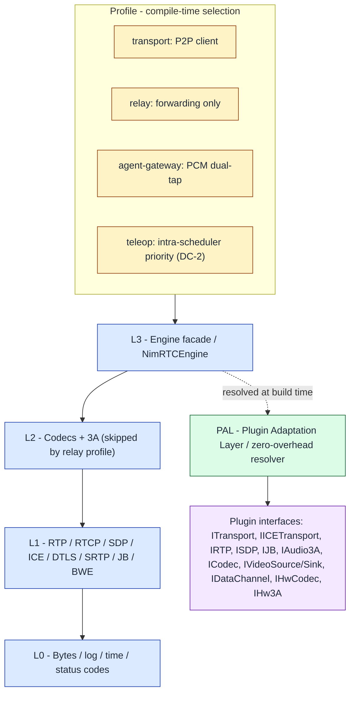

# NimRTC

[](LICENSE)
[](CHANGELOG.md)
[](https://en.cppreference.com/w/cpp/20)
[](#platform-support)
[](#build--ci)
[](CONTRIBUTING.md)

> **Latest release:** v1.0.2 (Stable) — patch release fixing the WebTransport ALPN mismatch and the oversized Windows bundle, and shipping the signing public key with the release (`v1.0.1` remains published and unchanged; the `v1.0.0` tag is retained as source milestone only and was never published as a GitHub Release). Public API frozen per [ADR-015](docs/adr/ADR-015-api-stability-policy.md); `NIMRTC_API_VERSION` = 10002, `NIMRTC_API_VERSION_PRE_RELEASE` = `""`. Chrome ↔ NimRTC data exchange (DC-1) via the Chrome WebTransport JS API (`new WebTransport(url)`, not `RTCPeerConnection.createDataChannel()`) over QUIC **PASS E1–E6** via `tests/chrome_interop_harness/run_webtransport_harness.py` + `interop/chrome/test_chrome_webtransport.html` against `examples/demo-wtserver` (datagram + bidi-stream echo). `EngineConfig::datachannel_backend` defaults to `"web_transport"`; the `"sctp"` backend was retired from the public selectors in v1.2.0 (it was an in-process loopback socket that could never reach a peer). See [CHANGELOG.md](CHANGELOG.md) `## [1.0.2]` and [docs/plan/v1.0-plan.md](docs/plan/v1.0-plan.md) §3 + §12.3.6.
>
> **Current `main` (post-v1.0.2, unreleased):** the trunk is ahead of the published tag by the
> **v1.1** release, which consolidates the former v1.1 / v1.2 / v1.3 drafts into one
> version target: the packaging + benchmark track, the transport / media / DTLS hardening
> track, and the quality-line items (shared adaptive jitter strategy, `src/modules/jb_strategy`;
> a simplified Goog-CC-style BWE — delay + loss hybrid estimation, **not** a full
> trendline port; RTCP feedback loop; engine-level `ref_frame` and video stats; GMSSL vendoring
> as a submodule + the SRTP backend seam; engine source split).
> Local suite on Windows/MSVC Debug: **651/651 PASS** (measured 2026-11-04).
> The packaging rules (`NIMRTC_INSTALL=ON` → `include/` + `lib/` + `lib/cmake/NimRTC/`) are landed
> on `main` and will ship in the next release; the published v1.0.2 bundle does **not** contain
> them yet. See [Current progress](#current-progress-v102-published--main-ahead) and
> [Roadmap](#roadmap) for the full picture.
>
> 🌐 **Other languages**: [Simplified Chinese](README.zh.md) · **Try the live demo**: [nimrtc.github.io/nimrtc/wasm](https://nimrtc.github.io/nimrtc/wasm/)

---

**A native C++ WebRTC alternative — embeddable, scene-assembled, swappable backends.**

One source tree ships a **P2P client**, a **`relay` gateway**, and runs on **embedded Linux aarch64**.
DTLS / RTP / 3A codecs are all pluggable; the DTLS crypto path can swap to **GMSSL** for GM/T-regulated
deployments without forking the trunk.

> **Note on terminology:** the gateway shipped by this source tree is the
> `relay` profile — single-strategy forwarding with compile-time L2 codec
> skip, per `docs/zh/architecture.md` §7.1. A from-scratch SFU module is
> *not* a deliverable: the §7 pre-1.0 decision window for SFU-1 / DC-3 /
> BENCH-1 closed as NO (BDFL, 2026-10-19 — SFU is not a project core goal;
> see `docs/plan/v1.0-plan.md` §7 + §12.5). The `profiles/sfu.json` and
> `profiles/sfu-agent.json` files remain in the tree as unregistered JSON —
> they carry the `sfu_enabled` marker and the `sfu-relay` transport
> strategy, but there is no `kProfileSfu` constant and they are not part of
> the shipped Profile set.

[Why NimRTC?](#why-nimrtc) · [Who is it for](#who-is-it-for) · [Quick Start](#quick-start) · [Hello, World](#hello-world) · [Architecture](#architecture-at-a-glance) · [Benchmarks](#benchmarks) · [Roadmap](#roadmap) · [FAQ](#faq)

---

## Why now?

WebRTC moved on, but the dominant implementation didn't.

- **libwebrtc** is the de-facto engine, but its build is multi-GB, its crypto and codecs are black-box, and the codebase is monolithic. Embedding it on aarch64 or auditing it against GM/T regulations is an exercise in pain.
- **AI Agents / teleop / embodied-AI robotics** need things libwebrtc doesn't expose cleanly — a pre/post-3A PCM tap, intra-scheduler strict-priority ordering (DC-2, see `sched.hpp` Scope note; not a wire-level cross-connection guarantee under the default `web_transport` backend), and a capture-to-decision frame-time API.
- **Xinchuang / regulated** environments need a swap-in path to GM/T cryptography, not a fork.

NimRTC is a from-scratch C++20 implementation that keeps the **wire-level interop** you need (verified against Chrome: Case D media over DTLS-SRTP, Case E data over the Chrome WebTransport JS API) and replaces the opaque monolith with a **compile-time layered, plugin-adapted engine** you can read, swap, and ship on aarch64.

---

## TL;DR

- **What:** An embeddable C++20 media engine for real-time communication — a from-scratch WebRTC alternative, **not a fork of libwebrtc**.
- **Why it exists:** libwebrtc is large, hard to embed, and its crypto/codecs are opaque. NimRTC keeps the wire-level interop and replaces the monolith with a layered, plugin-adapted engine you can read, swap, and ship on aarch64.
- **Current state:** **v1.0.2 is the latest published release** (Stable). The `main` trunk is
  post-v1.0.2 and unreleased, carrying one consolidated **v1.1** release:
  - **v1.1 — Quality + Packaging + Hardening:** reproducible transport-floor benchmarks
    (`tools/benchmark_latency.py`, `tools/benchmark_dc.py`) with CI artifacts; install rules
    (`NIMRTC_INSTALL=ON`) that produce `include/` + `lib/` + `lib/cmake/NimRTC/` so
    `find_package(NimRTC)` works from an installed tree, and the WebRTC APM prebuilt shipped
    alongside it; the transport-stack residuals (`ISctpSocket` lifecycle, ICE
    `last_recv_packet()` demux, unified `make_transport_instance()`, p99 strategy validator,
    non-standard video clock-rate negotiation, DTLS IPv6 `set_peer()`, NAT-rebinding
    `rehandshake()`); and the quality line — the RFC 3550 jitter estimator and the
    "base + 4·J" target-delay policy now live **once** in `src/modules/jb_strategy`, with the
    audio (`jb`) and video (`video_jb`) front-ends sharing it (video-side adaptive playout is
    opt-in via `EngineConfig::video_receiver_tuning.adaptive_playout`), plus a
    simplified Goog-CC-style BWE (delay + loss hybrid estimation — **not** a full
    trendline port), the RTCP feedback loop, engine-level `ref_frame` / video stats, GMSSL vendoring as a
    submodule, the SRTP backend seam and the engine source split.
  Public API is frozen per ADR-015 (`NIMRTC_API_VERSION` = 10002); breaking changes require a
  MINOR/MAJOR bump. Local suite on Windows/MSVC Debug: **651/651 PASS**.
  **In-process SFU relay (`nimrtc_sfu`), DC forwarding policy (DC-3), and `sfu-relay`
  benchmark (BENCH-1) were closed as NO on 2026-10-19 and remain off the critical path** per
  `docs/plan/v1.0-plan.md` §7 (SFU is not a project core goal).

---

## What's in the box

| | | |
|---|---|---|
| 🎯 **Compile-time layered (L0–L3)** | 🔌 **Public plugin interfaces** | 🪶 **12.55 MB static lib** (vs libwebrtc 150–250 MB) |
| 🧩 **Profiles for scenes, not forks** — `call` / `transport` / `relay` / `agent` / `agent-gateway` / `agent-low-latency` / `relay-agent` / `teleop` / `live` | 🔁 **Swappable DTLS backend** — wolfSSL (default) ↔ GMSSL (opt-in), public API unchanged | 🛡️ **GM/T crypto path** — DTLS/TLCP via GMSSL (SRTP still uses the international suites) |
| 📡 **Wire-level interop** — Chrome (Case D media + Case E via WebTransport JS API) | 🏗️ **4-platform CI** — Win / Linux x86_64 / macOS arm64 / Linux aarch64 | 🎛️ **Differentiated for AI Agent** — pre/post-3A PCM tap, ref_frame timeline |

---

## Why NimRTC?

No single feature here is brand new — but the **combination** is rare in the open-source WebRTC ecosystem in 2026:

| # | Differentiator | Why it matters |
|---|---|---|
| 1 | **Layered design + Profile composition (L0–L3)** | Compile-time layer selection. The same source tree ships a full P2P client *and* a `relay` gateway (`relay` profile skips L2 codecs; per `docs/zh/architecture.md` §7.1). **Note**: a from-scratch SFU module is *not* a deliverable (the §7 pre-1.0 decision window for SFU-1 / DC-3 / BENCH-1 closed as NO, 2026-10-19 — SFU is not a project core goal; see `docs/plan/v1.0-plan.md` §7 + §12.5). LiveKit/mediasoup are server-only; libwebrtc is monolithic. |
| 2 | **Multi-platform CI green** | Windows, Linux x86_64, macOS arm64, Linux aarch64 — all four pass build + unit tests. See [Platform support](#platform-support). |
| 3 | **PAL (Plugin Adaptation Layer)** | All capability swapping flows through `pal::*` with **zero runtime overhead** and an unchanged public API. See [ADR-009](docs/adr/ADR-009-pal-slice-1.md). |
| 4 | **Swappable DTLS backends** | The DTLS backend is a plugin: wolfSSL (default) or GMSSL, selected by `EngineConfig::dtls_name` without touching the public API. Most OSS WebRTC stacks hard-wire their crypto. (mbedTLS was the original backend and is kept as archival source only — it is no longer linked.) |
| 5 | **P2P client and relay from the same codebase** | One set of plugin interfaces serves both. In 2026's OSS WebRTC ecosystem, this is rare. (A from-scratch SFU module is *not* a project core goal — see `docs/plan/v1.0-plan.md` §7, BDFL 2026-10-19.) |

> **The plugin interfaces are the architectural seam.** They make the five points above work together. See [§ Plugin Architecture](#plugin-architecture) below.

---

## Who is it for?

| If you are… | NimRTC helps you… |
|---|---|
| Building a **P2P voice/video app** in C++ | Replace libwebrtc with something you can actually inspect, link statically, and ship at a few MB instead of hundreds. |
| Operating in a **Xinchuang / regulated** environment that mandates GM/T cryptography | Swap DTLS crypto to GMSSL (TLCP / SM2 / SM3 / SM4) without forking the engine. **Scope note:** the GM/T path covers the DTLS handshake — SRTP still uses the international AES suites (SM4-GCM SRTP is a later release). |
| Running on **embedded Linux aarch64** (Raspberry Pi, industrial SBCs, robotics) | Get real RTC on a constrained board with the same codebase that powers your desktop client. |
| Building **AI Agents / teleop / embodied-AI robotics** | Use the dual PCM tap (pre/post-3A), intra-scheduler strict-priority ordering (DC-2 scope note applies), and ref_frame timeline APIs. |
| Standing up an **relay** without rewriting protocol code | Compile the `relay` profile (L0+L1+L3) — same engine, no L2 codec. |

> **Not a fit if:** you need a turnkey browser-grade SDK today, or you only target mobile (iOS/Android are roadmap, not a current-track item).

## Download prebuilt v1.0.2

Each platform bundle ships the **vendored third-party dependency stack** for
that platform — the wolfSSL / libsrtp3 / libjuice / msquic headers and
libraries — so you can inspect and link the same crypto, SRTP, ICE and QUIC
primitives the engine uses without building them yourself.

> **The v1.0.2 bundle does not yet contain NimRTC's own headers, static library, or
> `NimRTCConfig.cmake`.** `find_package(NimRTC)` therefore does not work from the
> downloaded v1.0.2 bundle, and linking NimRTC itself still requires a source
> build (see [Quick Start](#quick-start) below). This is fixed on `main`: the
> `NIMRTC_INSTALL=ON` rules now produce `include/` + `lib/` + `lib/cmake/NimRTC/`
> (verified downstream on Windows; Linux downstream proof runs in `ci.yml` on every push), and the next release will ship them.

> **The v1.0.2 bundles also carry no WebRTC APM archives** — there is no
> `lib/webrtc_apm/` directory in any of the four tarballs — so a downloaded
> bundle provides no audio 3A at all. The release body states the per-platform
> 3A status as "the build used the real WebRTC APM, but this bundle ships no APM
> archives"; the archives are installed by the `main` install rules and will
> appear in the next release.

- Release page: [v1.0.2](https://github.com/NimRTC/nimrtc/releases/tag/v1.0.2)
- Assets: `nimrtc-1.0.2-<platform>.tar.xz` + `.sha256` + `.asc` (`sbom.json` included)

```bash
tar -xJf nimrtc-1.0.2-linux-x86_64-gcc.tar.xz
sha256sum -c nimrtc-1.0.2-linux-x86_64-gcc.tar.xz.sha256
gpg --verify nimrtc-1.0.2-linux-x86_64-gcc.tar.xz.asc
```

Signing key fingerprint: `114154CFEC3F5EE5A8D2D313BEACFBB55871CC06`.

---

## Quick Start

### Prerequisites

- **CMake ≥ 3.25**
- **MSVC 19.43+** (Windows 10/11) · **GCC 11+ / Clang 12+** (Linux) · **Apple Clang 15+** (macOS 14+)
- **Ninja** (recommended)
- **Python 3.8+** (for the e2e harness)

Verify your toolchain:

```bash
python tools/check_prerequisites.py
```

### Clone

```bash
git clone --recurse-submodules https://github.com/NimRTC/nimrtc.git
cd nimrtc
```

### Build (Option A — interactive scripts)

```bat
:: Windows
.\scripts\build.bat
.\scripts\build.bat --release     :: Release config
```

```bash
# Linux / macOS
bash scripts/build.sh
bash scripts/build.sh --preset=release
```

### Build (Option B — manual CMake)

```bash
cmake --preset debug            # or: debug.msvc, debug, release, release.aarch64
cmake --build build --config Debug -j
```

> **Preset reference:** see [`CMakePresets.json`](CMakePresets.json). The `dev.*` presets are hidden and inherited by visible ones; use `debug.msvc` / `release.msvc` / `debug.aarch64` / `release.aarch64` etc.

### Run tests

```bash
ctest --preset tests --output-on-failure
```

### Run the loopback-p2p smoke test

Two in-process agents handshake over real UDP — no signaling server needed.

```bash
cmake -B build -DNIMRTC_BUILD_EXAMPLES=ON -DCMAKE_BUILD_TYPE=Debug
cmake --build build --target loopback-p2p
./build/examples/Debug/loopback-p2p        # or .exe on Windows
```

### Run the Chrome interop acceptance suite

```bash
python tools/run_e2e_acceptance.py
ls build/e2e/        # artifacts land here
```

> **First-build note:** all third-party deps are managed via git submodules + SHA-pinned `src/third_party/vendor.json`. The `--recurse-submodules` flag on clone handles this.

---

## Hello, World

Two engines complete an SDP exchange, run ICE connectivity checks on the loopback interface,
and reach the `connected` state — in **~30 lines of C++**. This is the same code path that
ships in `examples/loopback-p2p/`:

```cpp
#include <nimrtc/engine/engine.hpp>
#include <thread>
#include <chrono>

using namespace nimrtc::engine;
using namespace std::chrono_literals;

int main() {
    EngineConfig cfg;
    cfg.local_bind_address    = "127.0.0.1";
    cfg.local_port_range_begin = 51000;
    cfg.local_port_range_end   = 51099;
    cfg.pcm_sample_rate_hz     = 48000;
    cfg.pcm_channels           = 1;

    // Offerer (CONTROLLING)
    NimRTCEngine A(cfg);
    A.pre_open();
    A.open();
    auto offer = A.create_offer();

    // Answerer (CONTROLLED) — pre-set remote ICE so libjuice picks the right role
    NimRTCEngine B(cfg);
    B.pre_open();
    B.set_remote_ice(extract_ice_block(offer));   // helper, see examples/
    B.open();
    auto answer = B.process_remote_sdp(offer);

    A.process_remote_sdp(*answer);

    // Drive both engines until ICE is up on both sides
    while (A.ice_state_string() != "connected" || B.ice_state_string() != "connected") {
        A.tick();
        B.tick();
        std::this_thread::sleep_for(10ms);
    }
    return 0;
}
```

Three things worth noticing:

1. **No mock objects, no test harness** — the engine talks to itself over real UDP on
   `127.0.0.1`. The same `NimRTCEngine` ships in your app; there is no separate "test API".
2. **DTLS, SRTP, RTP, jitter buffer, ICE** are all wired inside `tick()` — the user code is
   intentionally free of any protocol state.
3. **The plugin interfaces don't leak into the application.** If you later swap wolfSSL for
   GMSSL, or in-tree 3A for a hardware backend, this code does not change.

Full source: [`examples/loopback-p2p/loopback-p2p.cpp`](examples/loopback-p2p/loopback-p2p.cpp).
For Chrome-baseline interop (offer from Chrome, answer from NimRTC, SDP↔ICE manually bridged),
see [`interop/`](interop/) and [`tools/run_e2e_acceptance.py`](tools/run_e2e_acceptance.py).

---

## Architecture at a glance

NimRTC is **four compile-time layers (L0–L3) sitting on top of a Plugin Adaptation Layer (PAL)**.
A **profile** (also chosen at build time) decides which layers are even linked into the binary —
this is how the same source tree ships both a P2P client *and* a `relay` gateway
(`relay` profile skips L2 codecs; per `docs/zh/architecture.md` §7.1).
**An from-scratch SFU module is not a deliverable** — the §7 pre-1.0 decision
window closed as NO (BDFL, 2026-10-19; see `docs/plan/v1.0-plan.md` §7 + §12.5).

### Layer overview

```
            ┌──────────────────────────────────────────────────────┐
            │  PROFILE  —  compile-time selection                  │
            │  call (P2P) │ transport │ relay │ agent │            │
            │  agent-gateway │ agent-low-latency │ teleop │ live   │
            └──────────────────────────────────────────────────────┘
                                    │
                                    ▼
            ┌──────────────────────────────────────────────────┐
            │  L3  Engine façade                                │
            │  NimRTCEngine wires the chosen profile + plugins  │
            └──────────────────────────────────────────────────┘
                                    │
                                    ▼
            ┌──────────────────────────────────────────────────┐
            │  L2  Codecs + 3A          (skipped by `relay`)       │
            │  Opus / G.711 / VP8 / H.264 · audio 3A pipeline  │
            └──────────────────────────────────────────────────┘
                                    │
                                    ▼
            ┌──────────────────────────────────────────────────┐
            │  L1  Wire / state                                 │
            │  RTP · RTCP · SDP · ICE · DTLS · SRTP · JB · BWE  │
            └──────────────────────────────────────────────────┘
                                    │
                                    ▼
            ┌──────────────────────────────────────────────────┐
            │  L0  Primitives                                   │
            │  bytes · log · time · status codes                │
            └──────────────────────────────────────────────────┘

       ┌──────────────────────────────────────────────────────┐
       │  PAL  —  Plugin Adaptation Layer                       │
       │  Every capability is resolved at build time.           │
       │  Zero runtime indirection, public API unchanged.       │
       └──────────────────────────────────────────────────────┘
                                    │
                                    ▼
       ┌──────────────────────────────────────────────────────┐
       │  PLUGIN INTERFACES  (header-only, in `src/plugins/`)   │
       │                                                       │
       │  ITransport · IICETransport · IRTP · ISDP · IJB       │
       │  IAudio3A · ICodec                                    │
       │  IVideoSource · IVideoSink · IDataChannel             │
       │  IHwCodec · IHw3A                                     │
       └──────────────────────────────────────────────────────┘
```

The same diagram, rendered natively by GitHub:



### What each piece does

| Layer | Lives in | Responsibility |
|---|---|---|
| **Profile** | `cmake/profiles/*.cmake` | A pure build-time selection: which of L0–L3 are linked, which plugin backends are picked. No runtime dispatch — selecting `relay` literally omits L2 from the binary. |
| **L3 Engine** | `src/engine/` | The single public façade (`NimRTCEngine`). Wires plugins together; contains **no concrete module headers** in its API — see Layout Invariant 4 in [`ARCHITECTURE.md`](ARCHITECTURE.md). |
| **L2 Codecs + 3A** | `src/modules/opus/`, `…/audio3a/`, `…/video_payload/` | Encode/decode and the audio 3A pipeline. The `relay` profile compiles without L2, halving the codec surface in the resulting binary. |
| **L1 Wire / state** | `src/modules/{rtp,sdp,ice,dtls,srtp,jb,bwe}/` | The protocols and state machines that talk to the network. In-house (not vendored) per the §11 vendoring rule. |
| **L0 Primitives** | `src/core/`, `src/log/` | Status codes, byte buffers, monotonic time, logging. Header-only where possible. |
| **PAL** | `src/plugins/pal/` | Resolves every plugin capability at build time via a small registry. After resolution, plugin calls are direct (zero indirection), so the public API surface is unchanged from the engine’s point of view. See [ADR-009](docs/adr/ADR-009-pal-slice-1.md). |
| **Plugin interfaces** | `src/plugins/` | Header-only abstract bases — the *seam*. Each swap (wolfSSL ↔ GMSSL; in-tree ↔ HW 3A; libjuice ↔ custom ICE) plugs in through one of these. |

### Data flow, in one paragraph

A frame enters via `IVideoSource` (or microphone capture for audio), gets RTP-packeted in L1,
sent down `ITransport`, protected by `IDTLS`/`ISRTP` on the wire. On the receive side, the
peer runs the inverse: `ITransport` → jitter buffer (`IJB`) → decoder in L2 → audio 3A
(`IAudio3A`) → `IVideoSink` / audio render. BWE feedback loops close on RTCP. Everything
above L0 is replaceable through a plugin interface — that’s why a fork-free swap to GMSSL or
a HW 3A backend is a one-CMake-option change.

Detailed design: [`docs/zh/architecture.md`](docs/zh/architecture.md) (canonical, Chinese) ·
see [ADR-012](docs/adr/ADR-012-zh-docs-layout.md) for the docs-layout decision. English
technical deep-dives are on the roadmap.

---

## Benchmarks

The headline reason to choose NimRTC over libwebrtc is **size** — both binary footprint and source-tree complexity.

### Binary size (Windows x86_64, MSVC, Release)

| Artifact | NimRTC | libwebrtc (reference) |
|---|---|---|
| Static lib `nimrtc_engine` | **12.55 MB** | 150–250 MB |
| Example `loopback-p2p` (full client) | **2.42 MB** | 50–80 MB (typical WebRTC sample) |
| Example `demo-p2p` | **2.46 MB** | — |
| **Estimated static-link footprint** | **~22.4 MB** | **~100 MB minimum** |

> Measured on: Windows 10 x86_64, MSVC, Release (local `build/`, `nimrtc_engine.lib` 13,164,084 bytes = 12.55 MB; example binaries from `build/examples/Release/`). Run `python tools/benchmark_size.py build --markdown` to re-measure after any build or option change.
>
> **Note:** the static archive alone is 12.55 MB; the "~5.6 MB" figure quoted on the GitHub About page and in older docs predated the current module set and referred to an older build. The About page now quotes ~12.6 MB, matching the measured value above.

### Source-tree complexity

| Project | Source LoC | Languages |
|---|---|---|
| **NimRTC** | ~30 K (incl. vendored) | C++20 only |
| libwebrtc | ~5.5 M | C++ (mixed C++03/11/14/17) + internal bindings |

> Source-LoC numbers are rough, measured via `cloc` excluding vendored dependencies. libwebrtc's number is widely cited and varies by platform/branch.

### What this means in practice

- **Embeddable** — NimRTC links into your host app at a few MB instead of pulling in a 100+ MB blob.
- **Inspectable** — You can `grep` the entire engine source tree. Auditing a security fix or a regulatory review against libwebrtc is impractical.
- **Buildable on a laptop** — NimRTC builds end-to-end in minutes on commodity hardware. libwebrtc's source fetch alone is GB-scale.
- **Embedded-friendly** — On aarch64 with `-Os`, NimRTC's link footprint drops further; libwebrtc's is rarely deployed outside x86_64 / arm64 servers.

### Caveats

- libwebrtc numbers are **public reference values** that vary by platform, branch, and codec set. Re-validate before publishing marketing claims.
- NimRTC numbers depend on which plugins / codecs you build (`-DNIMRTC_PLUGINS_NVENC=ON` etc.). Run `benchmark_size.py` after any option change.

### Transport-floor baselines (localhost UDP loopback, v1.1)

Track A baselines are transport-floor numbers, not engine glass-to-glass claims. Typical ranges on Windows 10 x86_64 (local `build/`; loopback numbers vary run to run):

| Bench | Payload | Typical range |
|---|---|---|
| `bench_latency.json` (1000 × 172 B echo) | 172 B (~20 ms Opus mono + RTP header) | p50 **~10 µs**, p99 **~20–35 µs**, mean jitter **<1 µs** |
| `bench_dc.json` datagram plane (2000 msgs) | 256 B | **~60–80k pps / ~120–165 Mbps** |
| `bench_dc.json` datagram plane (2000 msgs) | 1200 B | **~60–80k pps / ~570–800 Mbps** |
| `bench_dc.json` bidi-stream-chunk plane (2000 msgs) | 16384 B | **~60–70k pps / ~8–9 Gbps** |
| `bench_weaknet.json` loss-5pct tier (200 × 1200 B) | 1200 B, 5% loss + 5 ms base | delivery **~0.95**, p50 **~5–7 ms**, p99 **~5–8 ms** |
| `bench_weaknet.json` jitter-100ms tier (200 × 1200 B) | 1200 B, 20 ms base + 0–100 ms jitter | delivery **1.0**, p50 **~74–76 ms**, p99 **~118–121 ms** |
| `bench_weaknet.json` cap-1mbps tier (200 × 1200 B) | 1200 B, 1 Mbps pace + 5 ms base | delivery **1.0**, p50 **~15–17 ms**, p99 **~19–31 ms** |
| `bench_weaknet_netem.json` loss-5pct tier (200 × 1200 B, Linux) | 1200 B, 5% loss + 5 ms base | delivery **~0.94–0.95**, p50 **~5.1 ms**, p99 **~5.2 ms** |
| `bench_weaknet_netem.json` jitter-100ms tier (200 × 1200 B, Linux) | 1200 B, 20 ms base + 0–100 ms jitter | delivery **1.0**, p50 **~68 ms**, p99 **~118 ms** |
| `bench_weaknet_netem.json` cap-1mbps tier (200 × 1200 B, Linux) | 1200 B, 1 Mbps pace + 5 ms base | delivery **1.0**, p50 **~15.1 ms**, p99 **~15.2 ms** |

> Reproduce with `python tools/benchmark_latency.py --count 1000`, `python tools/benchmark_dc.py`, and `python tools/benchmark_weaknet.py --count 200 --size 1200`; artifacts land in `build/e2e/bench_latency.json` + `build/e2e/bench_dc.json` + `build/e2e/bench_weaknet.json`. Exact numbers are machine- and load-dependent — the checked-in JSON is one local sample, not a pass/fail threshold. The weak-network tiers run through an in-process userspace shaper over localhost UDP (deterministic seeded impairments), so they are reproducible without root; the Linux `tc qdisc netem` counterpart is [`tools/benchmark_weaknet_netem.sh`](tools/benchmark_weaknet_netem.sh) (needs root + iproute2) and lands in `build/e2e/bench_weaknet_netem.json`. A rate-limited tier is paced at 90% of the cap and its reading includes the link's serialization time, so the numbers above are the link's delay rather than a queue the sender built up itself. Engine glass-to-glass latency/jitter/MOS still depend on platform, codec, network, and target use case — profile-specific benchmarks land once P2 (PCM tap) and P3 (BWE + ref_frame) land.

See [`tools/benchmark_size.py`](tools/benchmark_size.py), [`tools/benchmark_latency.py`](tools/benchmark_latency.py), [`tools/benchmark_dc.py`](tools/benchmark_dc.py), [`tools/benchmark_weaknet.py`](tools/benchmark_weaknet.py), and [`tools/benchmark_weaknet_netem.sh`](tools/benchmark_weaknet_netem.sh) for the measurement tools.

---

## Plugin Architecture

NimRTC exposes nearly every "swappable" capability through plugin interfaces defined in [`src/plugins/include/nimrtc/plugins/*.hpp`](src/plugins/include/nimrtc/plugins/) ([ADR-001](docs/adr/ADR-001-plugin-system.md)). The engine resolves them through PAL ([ADR-009](docs/adr/ADR-009-pal-slice-1.md)).

| Aspect | Value of explicit plugin interfaces | Cost of *not* having them |
|---|---|---|
| **Backend swapping** | ICE ↔ QUIC transport, RTP debugger, 3A bypass — same engine code | Each backend forks the engine → OCP violations |
| **Test isolation** | `MockTransport` / `NullAudio3A` / `CountingJitterBuffer` injected, no mock framework needed | gmock/virtual mocks leak into production code |
| **Enterprise customisation** | GMSSL DTLS, 3A bypass, SLA instrumentation — compile-time plugin swap, single trunk | Forks drift, `#ifdef` becomes unmaintainable |
| **Third-party ecosystem** | Write `MyAudio3A : plugins::IAudio3A`, link with `-DNIMRTC_MODULE_AUDIO3A=MyAudio3A` | Users must `#include <nimrtc/audio3a/...>` — encapsulation breaks |
| **Failure-domain isolation** | Plugin interface status codes are the contract | Errors propagate inconsistently across modules |

**Comparison baseline:** GStreamer / FFmpeg / OBS / PipeWire all use plugin architectures — but in the **WebRTC** ecosystem (libwebrtc / Pion / LiveKit / mediasoup / janus), only Pion and libwebrtc internally have similar abstractions. **NimRTC exposes them publicly and runs both P2P and `relay` on the same set of interfaces** (the `relay` profile skips L2 codecs; a from-scratch SFU module is *not* a deliverable — see `docs/plan/v1.0-plan.md` §7).

Plugins are the evolution mechanism: P0–P1 use built-in implementations; P2–P3 differentiating features (dual 3A tap, intra-scheduler strict-priority ordering, ref_frame timeline) also ship as plugins (`IJB::set_render_delivered`, `IRTP::set_ref_frame`).

---

## How NimRTC compares

A pragmatic matrix for evaluators — read across the rows that matter to you:

| | **NimRTC** | **libwebrtc** | **Pion** | **mediasoup** | **LiveKit** |
|---|---|---|---|---|---|
| **Language** | C++20 | C++ (mixed C++03/17) | Go | C++ | Go |
| **P2P client + relay from one codebase** | ✅ | ⚠️ libwebrtc + separate server | ❌ | ❌ SFU only | ❌ SFU only |
| **Public plugin seam** | ✅ every layer | ❌ internal | ⚠️ partial | ⚠️ server-side | ⚠️ server-side |
| **Static-link footprint** | **12.55 MB** | 150–250 MB | n/a (Go) | server-side | server-side |
| **Embedded Linux aarch64** | ✅ CI green | ⚠️ unmaintained ports | ❌ | ❌ | ❌ |
| **GM/T (GMSSL) crypto swap** | ✅ plugin swap, no fork (DTLS layer) | ❌ patch and rebuild | ❌ | ❌ | ❌ |
| **AI Agent / 3A-bypass hooks** | ✅ `pre/post-3a` PCM tap (P2) | ❌ APM is opaque | ❌ | ❌ | ❌ |
| **ref_frame / frame-aligned timeline** | 🚧 P3 | ❌ | ❌ | ❌ | ❌ |
| **Wire-level Chrome interop** | ✅ Case D green (media over DTLS-SRTP) + Case E green (data over Chrome WebTransport JS API) | ✅ | ✅ (Go-only) | ✅ via browser SDK | ✅ via browser SDK |
| **Production maturity (2026)** | Stable (v1.0.2 published) | Production-grade | Production-grade | Production-grade | Production-grade |

**Where NimRTC wins outright:** aarch64 embedded, GM/T crypto path (DTLS layer), AI Agent hooks, single-trunk
P2P+relay (where `relay` is the single-strategy gateway profile that compiles out L2 codecs; a from-scratch SFU module is not a deliverable — see `docs/plan/v1.0-plan.md` §7, BDFL 2026-10-19).
**Where NimRTC loses:** ecosystem breadth, codec coverage, browser-engine parity, and
years of hardening. Pick accordingly.

---

## Profiles

Profiles are **compile-time configurations**, not runtime dispatch. Format: see [ADR-010](docs/adr/ADR-010-profile-json-format.md) (JSON is the first-party format).

| Profile | Layers | Use case |
|---|---|---|
| `call` | L0+L1+L2+L3 | 1:1 bidirectional voice/video call — the default P2P client (Chrome interop) |
| `transport` | L0+L1+L3 (**skips L2**)| Embedded ICE/DTLS-SRTP gateway — pure passthrough, no media processing |
| `relay` | L0+L1+L3 (**skips L2**)| Server-side forwarding without re-encoding |
| `agent` | L0+L1+L2+L3 | AI Agent SDK (voice/text, 1:1) — timeline + DC |
| `agent-gateway` | L0+L1+L2 (tap enabled) | AI Agent ingress — dual PCM tap + 3A bypass |
| `agent-low-latency` | L0+L1+L2+L3 | Agent pipeline where latency dominates (20 ms JB, AGC off) |
| `relay-agent` | L0+L1+L3 | Relay + AI Agent hybrid (N:1), timeline re-calibration |
| `teleop` | L0+L1+L2+L3 | Robot / embodied-AI teleoperation — intra-scheduler strict-priority ordering (DC-2 scope note applies) |
| `live` | L0+L1+L2+L3 | One-way broadcast / live streaming |

> Full matrix (9 shipped profiles, with per-field JB / 3A / BWE / DC settings) lives in
> [`docs/profiles.md`](docs/profiles.md). `cloudgame` (cloud rendering / streaming) is a
> **long-term candidate and is not in the shipped Profile set** — see
> [`docs/plan/v1.1-plan.md`](docs/plan/v1.1-plan.md) §2 Track V.
>
> The `profiles/` directory also carries two **unregistered** JSON files, `sfu.json` and
> `sfu-agent.json`. They carry the `sfu_enabled` marker and the `sfu-relay` transport
> strategy, but there is no `kProfileSfu` constant and they are not part of the shipped
> Profile set — the from-scratch SFU module was closed as NO on 2026-10-19
> (see `docs/plan/v1.0-plan.md` §7).

---

## Differentiated capabilities (for AI Agent / teleop / embedded)

These are **P2 / P3 targets**, not P0 features — listed here so you can plan ahead.

| Need | NimRTC differentiation | Status in current OSS WebRTC |
|---|---|---|
| **3A bypass** — Agent feeds PCM to ASR | `pre-3a / post-3a` dual PCM tap | WebRTC APM is opaque; no PCM mid-pipeline hook |
| **Ordered control vs media inside one Scheduler** — same-queue ordering, not cross-connection pre-emption | DC-2 strict-priority ordering applies only to packets enqueued into the same `Scheduler` instance. Under the default `web_transport` backend, media (Case D, DTLS-SRTP over ICE/UDP) and data (Case E, WebTransport over QUIC) are **two independent connections with independent congestion control**, so a video-heavy media path cannot starve — and cannot be pre-empted by — the data path at the wire level. The legacy `"sctp"` backend does not put the two planes on one connection either — it is an in-process loopback socket that never reaches a peer — so today no NimRTC backend gives the data plane wire-level priority against the media plane. See `src/modules/sched/include/nimrtc/sched/sched.hpp` § Scope note | DTLS-SCTP / DataChannel is best-effort only |
| **Capture-to-decision alignment** — Agent decisions tied to video frames | `ref_frame` timeline API | libwebrtc has no such abstraction; apps must build their own |

---

## Roadmap

The project now plans in **versioned tracks** rather than the old P1–P4 ladder. The
authoritative plan documents are `docs/plan/v1.*-plan.md`.

| Version | Label | Scope | Status |
|---|---|---|---|
| **v1.0.x** | Stable | WebTransport / msquic data plane (DC-1), intra-scheduler ordering (DC-2, see `sched.hpp` § Scope note), Chrome e2e Case D + E | ✅ **v1.0.2 published** 2026-11-03 |
| **v1.1** | Quality + Packaging + Hardening | Reproducible transport-floor benchmarks with CI artifacts; install rules + `NimRTCConfig.cmake` so `find_package(NimRTC)` works from an installed tree; APM prebuilt shipped with it; release hardening (signed tags, four-platform release legs); transport-stack residuals (`ISctpSocket` lifecycle, ICE `last_recv_packet()` demux, unified `make_transport_instance()`, ARQ tech-preview labelling); media/RTP (SDP `a=rtpmap` video clock rate, p99 strategy validator); DTLS P2 (IPv6 `set_peer()`, NAT-rebinding `rehandshake()`, pump re-entrancy guard); weak-network quality chain (simplified Goog-CC-style BWE, unified adaptive JB, RTCP feedback loop, netem weak-network baselines); `ref_frame` and command-to-frame APIs promoted to the engine's public surface; engine-level video stats; GMSSL vendoring as a submodule + SRTP backend seam; engine source split | 🟡 landed on `main`, awaiting the release-hardening gates |
| **v1.2+** | — | SM4-GCM SRTP implementation, `cloudgame` (long-term candidate), `takeover` (remote-vehicle takeover, P4) | ⏸️ planned |
| — | Closed | In-process SFU module (`nimrtc_sfu`), DC forwarding policy (DC-3), `sfu-relay` benchmark (BENCH-1) | ❌ **NO** — closed 2026-10-19, BDFL: SFU is not a project core goal (`docs/plan/v1.0-plan.md` §7) |

Full roadmap: [`docs/zh/architecture.md`](docs/zh/architecture.md) §13 ·
[`docs/plan/v1.1-plan.md`](docs/plan/v1.1-plan.md).

---

## Current progress (v1.0.2 published — main ahead)

What you can do today. The table below covers what shipped **up to and including v1.0.2**
(the published release); the block after it lists the work that is **landed on `main` but not
yet published**. Measured on Windows/MSVC Debug against a stock build: **651/651 PASS**
(2026-11-04; 3 tests skip when the real WebRTC APM is not part of the build).

| Capability | Status | Shipped in |
|---|---|---|
| v0.10 design + ADR decisions landed (ADR-009 / 010 / 011 / 012) | ✅ | v0.10 |
| Scaffolding — CMake, 4-platform CI, vendored deps | ✅ | v0.9.2 |
| Vendored libs (wolfSSL / libsrtp / libopus / libjuice / WebRTC APM) | ✅ | v0.9.2 |
| Chrome ↔ NimRTC P2P audio + video interop (Case D, Windows) | ✅ | v0.9.2 |
| 4-platform CI green — Win / Linux x86_64 / macOS arm64 / Linux aarch64 | ✅ | v0.9.2 |
| RFC 7587 Opus packetise / depacketise complete | ✅ | v0.9.2 |
| PAL Slice 1 — plugin-capability resolution, zero runtime overhead | ✅ | v0.10 |
| PAL Slice 2 — explicit `kDefaultRegistrars[]` self-registration table | ✅ | v0.10.1 (retroactively attributed in v0.10.3) |
| PAL Slice 3 — `NIMRTC_PLUGIN_ID()` compile-time-unique plugin id wrapper | ✅ | v0.10.1 (retroactively attributed in v0.10.3) |
| PAL Slice 4 — DTLS session factory via registry hook (`get_dtls_session("wolfssl")`) | ✅ | v0.10.2 |
| PAL Slice 5 — SCTP seam (`SctpStubFactory` id=`"stub"`) and interface wiring | ✅ | v0.10.2 |
| PAL Slice 6 — Raw UDP bypass (`ArqRawUdp` id=`"arq"`) + 4/4 real-loopback test | ✅ | v0.10.2 |
| PAL Slice 7.5 — `WebRtcClassicStackFactory` (id=`"webrtc-classic"`) | ✅ | v0.10.3 |
| PAL Slice 8 — 4 typed transport-layer registry hooks | ✅ | v0.10.2 |
| TAP-1 — PCM tap on WebRTC APM (`set_pre_process_tap` / `set_post_process_tap` + int16 ASR variant) | ✅ | v0.11.0 |
| TPAL-4 cleanup — `EngineConfig::dtls_name` field for DTLS backend selection | ✅ | v0.11.0 |
| PROFILE-1 — 5-variant Profile library (`relay` / `transport` / `agent` / `agent-gateway` / `relay-agent`), JSON schema v1.0 canonical | ✅ | v0.11.0 |
| Profile regression — `JsonFileMatchesBuiltinConstant` field-equality test across 32 subtests | ✅ | v0.11.0 |
| DEMO-1 — `demo-agent-gateway` (PCM tap → ASR/LLM mock using `agent-gateway` Profile) | ✅ | v0.11.0 |
| DISC-1 — GitHub Discussions enabled | ✅ | v0.11.0 |
| RFC-1 — RFC 001 (PCM Tap) Final | ✅ | v0.11.0 |
| Chrome ↔ NimRTC media interop e2e (Case D, all four platforms) | ✅ | v0.11.0 |
| TPAL-5 — SCTP usrsctp production backend (`UsrsctpSocketFactory` id=`"usrsctp"`) | ⏸️ **Deferred to v1.x** | The class is `@deprecated` and still compiles for opt-in callers; `sctp::register_default_plugins()` no longer auto-registers id="usrsctp". Forward direction: WebTransport over QUIC. See `docs/plan/v0.11-plan.md` §2.2 / §10. |
| ADR-014 — WebTransport / QUIC vendor decision (msquic chosen) | ✅ | v0.14.0 |
| DC-1 (WebTransport / msquic data plane) — msquic integration, `WebTransportMsQuicSession`, `WebTransportDataChannel`, `test_web_transport_msquic` 12/12, `test_web_transport_data_channel` 17/17, `test_datachannel_engine` 5/5, `test_sctp_usrsctp` 4/4 | ✅ | v0.14.0-beta.1 |
| DC-1 — Chrome e2e Case E (data exchange via the WebTransport JS API, not `createDataChannel()`) | ✅ **PASS E1–E6** | Chrome ↔ NimRTC datagram + bidi-stream echo (via `new WebTransport(url)`) PASS via `tests/chrome_interop_harness/run_webtransport_harness.py` + `interop/chrome/test_chrome_webtransport.html` against `examples/demo-wtserver`. Landed in v0.15.0, frozen in v1.0.0. |
| DC-2 — transport-layer (L1) strict-priority send scheduling within the `Scheduler` (RTP × DC ordering) | ✅ (intra-scheduler ordering only — see `sched.hpp` § Scope note; not a wire-level cross-connection guarantee under the default `web_transport` backend) | `src/modules/sched/tests/test_sched_priority_dc.cpp` 17/17; landed in v1.0.0. |
| SFU-1 — In-process SFU relay (`nimrtc_sfu` module, BUNDLE/rtcp-mux) | ❌ **Closed — NO** | Closed 2026-10-19 (BDFL: SFU is not a project core goal); off the critical path. See `docs/plan/v1.0-plan.md` §7 + §12.5. |
| DC-3 — DC forwarding policy in SFU relay context | ❌ **Closed — NO** | Inherits from SFU-1 (closed 2026-10-19). |
| BENCH-1 — `sfu-relay` benchmark pps/Mbps | ❌ **Closed — NO** | Inherits from SFU-1 (closed 2026-10-19). |
| H.264 hardware backends — NVENC encoder (Win/Linux), AMF encoder (Win), QSV encoder (Win/Linux), VA-API encoder (Linux), DXVA decoder (Win), OpenH264 software fallback | ✅ | v0.9.2 |
| H.264 hardware **decoding** — NVDEC (Win/Linux) | ✅ **implemented** — `src/modules/nvcodec/` ships a real CUVID decoder (parser + decoder + NV12 surface → host copy), driven by runtime dynamic loading of `nvcuvid.dll` / `libnvcuvid.so`. `VideoToolbox` (macOS) and `MediaCodec` (Android) remain **not implemented** — the backend entries exist so the seam stays stable, but `create()` returns `nullptr` and `available()` returns `false`; use the software H.264 path there. See the [H.264 backend matrix](docs/hw_plugin_seam.md#111-backend-matrix). | v1.1 |

### Landed on `main`, not yet published

These are in the trunk and will be part of the next release. There is **no `## [1.1.0]`
CHANGELOG entry yet** — the release-hardening track (four-platform release legs, signed tag)
has not closed.

| Capability | Status | Track |
|---|---|---|
| Packaging — `NIMRTC_INSTALL=ON` install rules (`cmake/NimRTCInstall.cmake`) producing `include/` + `lib/` + `lib/cmake/NimRTC/`; `find_package(NimRTC 1.0 REQUIRED)` consumer verified downstream on Windows and on Linux via the `ci.yml` install + downstream-proof leg | ✅ landed | v1.1 Track D |
| The installed bundle now carries the WebRTC APM prebuilt + its link-order manifest, so a downstream consumer links the real AEC/ANS/AGC | ✅ landed | v1.1 Track D |
| Transport-floor benchmark artifacts in CI (`bench_latency.json`, `bench_dc.json` as 14-day artifacts) | ✅ landed | v1.1 Track A |
| `ISctpSocket::open()/close()` lifecycle; `IICETransport::last_recv_packet()` + in-stack demux; unified `make_transport_instance()`; ARQ stack labelled tech-preview | ✅ landed | v1.1 Track Ts |
| Non-standard video clock rate negotiated from SDP `a=rtpmap`; `max_p99_ms` strategy validator (opt-in enforcement) | ✅ landed | v1.1 Track M |
| DTLS IPv6 `set_peer()` via `getaddrinfo`; NAT-rebinding `rehandshake()`; pump re-entrancy guard test | ✅ landed | v1.1 Track Dtls |
| Shared adaptive jitter strategy (`src/modules/jb_strategy`): RFC 3550 jitter estimator + "base + 4·J" target delay, shared by the audio and video jitter buffers; video adaptive playout is opt-in | ✅ landed | v1.1 Track Q2 |
| 3A stage brought in line with its own contract (input-domain level meters, honoured VAD / level flags, real APM reference signal, engine no longer mutates the caller's PCM) | ✅ landed | post-v1.0.2 fix |
| libsrtp converted to a real git submodule; the vendor manifest now distinguishes verified submodules from checked-in trees | ✅ landed | post-v1.0.2 chore |
| Simplified Goog-CC-style BWE (opt-in, AIMD stays the default; delay + loss hybrid estimation, not a full trendline port), RTCP feedback loop, netem weak-network baselines, engine-level `ref_frame` / video stats, GMSSL vendoring + SRTP seam, engine source split | ✅ landed | v1.1 Tracks Q1 / Q3 / Q4 / T / V / X / R |
| OHOS Stage 1 toolchain proof (`debug.ohos-arm64` zero errors, no unresolved symbols) | ⏸️ blocked — no OHOS SDK on this host | v1.1 Track O1 |

> v1.0.2 is the **published Stable** release — public API frozen per ADR-015
> (`NIMRTC_API_VERSION` = 10002, `NIMRTC_API_VERSION_PRE_RELEASE` = `""`);
> WebTransport / msquic data plane (DC-1) + intra-scheduler ordering (DC-2, see `sched.hpp` § Scope note);
> Chrome e2e Case E (DataChannel over the WebTransport JS API — `new WebTransport(url)`, **not** `RTCPeerConnection.createDataChannel()`; standard WebRTC DataChannel interop is **not** claimed; Firefox/Safari WebTransport support is incomplete) **PASS E1–E6** —
> datagram + bidi-stream echo against `examples/demo-wtserver` via
> `tests/chrome_interop_harness/run_webtransport_harness.py`.
> `EngineConfig::datachannel_backend` defaults to `"web_transport"`; the `"sctp"`
> backend was retired from the public selectors in v1.2.0 (it was an in-process
> loopback socket that could never reach a peer).
> `WebTransportDataChannel` (id `"web_transport"`) is the production backend per ADR-014.
> **In-process SFU relay (`nimrtc_sfu`), DC forwarding policy (DC-3), and `sfu-relay`
> benchmark (BENCH-1) were closed as NO on 2026-10-19** per `docs/plan/v1.0-plan.md` §7
> (BDFL: SFU is not a project core goal); they stay off the critical path.

---

## Platform support

| Platform | Arch | Status |
|---|---|---|
| Windows | x86_64 | ✅ Supported |
| Linux | x86_64 | ✅ Supported |
| macOS | arm64 | ✅ Supported |
| Linux | aarch64 | ✅ Supported (compile-green; deployment validate on target hardware) |

Details in [CHANGELOG](CHANGELOG.md) "Platform support matrix".

---

## Build & CI

### CMake options

| Option | Default | Effect |
|---|---|---|
| `NIMRTC_BUILD_TESTS` | **ON** | Build gtest unit tests |
| `NIMRTC_BUILD_EXAMPLES` | OFF | Build the `loopback-p2p` smoke example |
| `NIMRTC_BUILD_DOCS` | OFF | Build Doxygen API docs |
| `NIMRTC_VENDORED` | **ON** | Use vendored `src/third_party/*` libraries |
| `NIMRTC_ASAN` | OFF | AddressSanitizer (Debug + GCC/Clang/MSVC ≥ 2019) |
| `NIMRTC_UBSAN` | OFF | UndefinedBehaviorSanitizer |
| `NIMRTC_WARNINGS_AS_ERRORS` | **ON** | Treat warnings as errors |
| `NIMRTC_VENDORED_WEBRTC_APM` | **ON** | Use vendored WebRTC APM library |
| `NIMRTC_INSTALL` | OFF | Enable `install()` rules — `include/` + `lib/` + `lib/cmake/NimRTC/` (Track D packaging) |
| `NIMRTC_ENABLE_DTLS_GMSSL` | OFF | Build the GMSSL-backed DTLS factory (id=`gmssl`); uses the vendored submodule at `src/third_party/gmssl/src` (pin v3.2.0), default OFF so non-GM builds pay zero cost |
| `NIMRTC_PLUGINS_NVENC` | OFF | NVIDIA NVENC H.264 **encoder** (Win/Linux) |
| `NIMRTC_PLUGINS_NVDEC` | OFF | NVIDIA NVDEC H.264 **decoder** (Win/Linux) — CUVID parser + decoder via runtime dynamic loading of `nvcuvid.dll` / `libnvcuvid.so`; the decoder is a separate one-way backend and is paired with the encoder through the `HwCompositeCodec` adapter so a single `IVideoCodec` covers both directions. |
| `NIMRTC_PLUGINS_AMF` | OFF | AMD AMF (Windows) |
| `NIMRTC_PLUGINS_QSV` | OFF | Intel QSV via libvpl/oneVPL |
| `NIMRTC_PLUGINS_DXVA` | OFF | Microsoft DXVA/MF (Windows) |
| `NIMRTC_PLUGINS_VAAPI` | OFF | Linux VA-API |
| `NIMRTC_PLUGINS_OPENH264` | OFF | OpenH264 software fallback |

> Per-module `NIMRTC_MODULE_*` switches (RTP, SDP, JB, JB_STRATEGY, BWE, AUDIO3A, ICE, SRTP,
> DTLS, OPUS, SCHED, DATACHANNEL, SESSION, ASSEMBLY, VIDEO_*) are also available and all
> default to **ON**; see the root `CMakeLists.txt`.

### Repository layout

```
nimrtc/
├── CMakeLists.txt             # Root CMake (C++20, options above)
├── CMakePresets.json          # Presets: dev, debug, release, asan, ci.{linux,windows,macos}
├── docs/                      # Technical doc (zh/en), ADRs, plans, security notes
├── examples/
│   ├── loopback-p2p/          # Two-agent ICE handshake smoke test
│   ├── demo-p2p/              # Full P2P client demo
│   ├── demo-wtserver/         # WebTransport / QUIC server (Case E peer)
│   ├── demo-agent-gateway/    # PCM tap → ASR/LLM mock on the `agent-gateway` profile
│   └── wasm-demo/             # /wasm/ landing page
├── profiles/                  # Profile library — one JSON per shipped Profile (9)
├── src/
│   ├── core/                  # bytes.hpp, log, time, status codes (L0)
│   ├── log/                   # Logger implementation
│   ├── engine/                # NimRTCEngine façade (top-level entry)
│   ├── dtls/                  # DTLS seam — wolfSSL + GMSSL backends
│   ├── sctp/                  # SCTP seam — stub + usrsctp
│   ├── transport/             # Transport stacks + strategies (webrtc-classic, raw-udp-arq, sfu-relay)
│   ├── raw_udp/              # Raw UDP transport
│   ├── web_transport/         # WebTransport / QUIC session (msquic)
│   ├── modules/               # 24 self-contained modules (see below)
│   ├── plugins/               # Public plugin interfaces (ADR-001)
│   └── third_party/           # Vendored deps (see table below)
├── tests/                     # Cross-module gtest integration tests
├── interop/                   # Chrome interop harness (media + WebTransport DataChannel)
├── cmake/                     # Shared CMake helpers
├── tools/                     # Vendor scripts, benchmarks, fuzzers, profiling helpers
└── .github/workflows/         # ci.yml · interop.yml · release.yml · wasm-demo-pages.yml
```

The `src/modules/` tree holds 24 self-contained modules — each with its own
`CMakeLists.txt` + `include/` + `src/` + `tests/`:

`assembly` · `audio3a` · `bwe` · `datachannel` · `dtls` · `h264` · `ice` · `jb` ·
`jb_strategy` · `opus` · `rtp` · `sched` · `sdp` · `session` · `srtp` · `video_frame` ·
`video_jb` · `video_payload` · `video_pipeline` · `video_rtcp_feedback` ·
`video_sdp_attributes` · `video_sink` · `video_source` · `video_stats`

### Vendored third-party versions

Pinned in [`src/third_party/vendor.json`](src/third_party/vendor.json) (SHA-verified by
`tools/check_vendor.py` in CI). The **Submodule** column distinguishes a real git submodule
(gitlink in the index) from a tree that is still checked into this repository.

| Library | Version | Path | Submodule |
|---|---|---|---|
| `wolfssl` | v5.9.2-stable | `src/third_party/wolfssl/src` | ✅ yes |
| `libopus` | v1.6.1 | `src/third_party/libopus/src` | ✅ yes |
| `libsrtp` | main | `src/third_party/libsrtp/src` | ✅ yes (converted 2026-11-03) |
| `nlohmann_json` | v3.11.3 | `src/third_party/nlohmann_json` | ✅ yes (header-only) |
| `googletest` | v1.12.0 | `src/third_party/googletest` | ✅ yes |
| `msquic` | master (NimRTC fork) | `src/third_party/msquic` | ✅ yes |
| `libjuice` | master | `src/third_party/libjuice/src` | ❌ checked-in tree (has a local SO_REUSEADDR patch) |
| `mbedtls` | 4.2.0 | `src/third_party/mbedtls/src` | ❌ archival only — no longer linked |
| `webrtc_audio_processing` | master | `src/third_party/webrtc_audio_processing` | ❌ fetched at build time (Meson), patched in-tree |

> `usrsctp` is also vendored under `src/third_party/usrsctp` for the SCTP seam.

---

## FAQ

### "Could not find Ninja"

```bash
# Ubuntu / Debian
sudo apt install ninja-build
# Fedora / RHEL
sudo dnf install ninja-build
# macOS
brew install ninja
# Windows (Chocolatey)
choco install ninja
```

### MSVC errors "MSB8020" / "v143 not found"

You're in a non-VS-2022 Developer Prompt. Open **"x64 Native Tools Command Prompt for VS 2022"** and reconfigure.

### "WebRTC APM pre-built library not found"

Skip 3A entirely:

```bash
cmake --preset dev -DNIMRTC_VENDORED_WEBRTC_APM=OFF
```

Or fetch the prebuilt:

```bash
python tools/fetch_webrtc_apm.py
cmake --build build
```

### GCC too old for `-std=c++20`

| Distro | Default GCC | Upgrade |
|---|---|---|
| Ubuntu 20.04 / Debian 11 | GCC 9–10 | `sudo apt install gcc-11 g++-11 && export CC=gcc-11 CXX=g++-11` |
| Ubuntu 22.04 / Debian 12 | GCC 11–12 | ✅ Use as-is |
| Fedora 36+ | GCC 12+ | ✅ Use as-is |
| RHEL / Rocky 8 | GCC 8 | `sudo dnf install gcc-toolset-11 && source /opt/rh/gcc-toolset-11/enable` |
| CentOS 7 | GCC 4.8 | ❌ Not supported — upgrade OS or use a container |
| Arch Linux | GCC 13+ | ✅ Use as-is |
| macOS | Apple Clang | Xcode ≥ 15 required (`clang++ --version` to check) |

### Linker errors / "undefined reference"

1. Submodules not initialised — `git submodule update --init --recursive`
2. Compiler < GCC 11 — see table above
3. Stale build cache — `rm -rf build && cmake --preset dev && cmake --build build -j`

### How do I verify my toolchain without running CMake?

```bash
python tools/check_prerequisites.py             # full check
python tools/check_prerequisites.py --compiler  # compiler only
```

---

## Documentation & language notes

- **Canonical technical doc:** [`docs/zh/architecture.md`](docs/zh/architecture.md) (Chinese — see [ADR-012](docs/adr/ADR-012-zh-docs-layout.md)).
- **Architecture decisions:** [`docs/adr/`](docs/adr/) (Chinese summaries, code/identifiers in English).
- **RFCs:** [`docs/rfcs/`](docs/rfcs/) — formal design records.
  - [RFC 001: PCM tap](docs/rfcs/rfc-001-pcm-tap.md) — Final
- **Standalone docs site:** docs-zh.nimrtc.dev — planned, **not live yet**. The live demo at
  [nimrtc.github.io/nimrtc/wasm](https://nimrtc.github.io/nimrtc/wasm/) is the currently
  reachable public artifact.

---

## Contributing & governance

- **Issues:** bugs, feature requests, interop compatibility feedback — preferred channel.
- **Pull Requests:** read [`CONTRIBUTING.md`](CONTRIBUTING.md); commits must be DCO-signed (`git commit -s`). No CLA.
- **Interop CI:** the `interop/` directory runs in CI on Windows (media Case D + DataChannel Case E). Chrome (pinned stable) is the current baseline browser; Firefox is **not** part of the automated matrix yet.
- **Security:** private channel — see [`SECURITY.md`](SECURITY.md).
- **Vendoring policy:** crypto / codecs / SCTP / 3A are vendored; RTP / RTCP / SDP / JB / BWE / ICE state machines / timeline scheduling are written in-house. See [`docs/zh/architecture.md`](docs/zh/architecture.md) §11.
- **End-to-end acceptance standards:** [ADR-011](docs/adr/ADR-011-teleop-metrics-caliber.md) clarifies that the engine carries only single-hop budget; DB31/T 1505-2024 / T/SSITS 2003-2023 are the integrator's responsibility.

---

## License

- **Project:** [Apache-2.0](LICENSE)
- **Third-party:** see [`NOTICE`](NOTICE) and [`docs/zh/architecture.md`](docs/zh/architecture.md) §11.

---

## Community

💬 **[GitHub Discussions](https://github.com/NimRTC/NimRTC/discussions)** — structured community channel.

| Category | Purpose | Who posts | Guidelines | Example topics |
|---|---|---|---|---|
| **Announcements** | Release notes, security advisories | Maintainers only | Admin-only posting; replies allowed | v0.11.0 Beta released · Security: CVE-YYYY-XXXX |
| **General** | Open Q&A, introductions, icebreakers | Anyone | One thread per topic; no feature proposals | "How does ICE candidate gathering work?" · "First time evaluating NimRTC" |
| **Ideas** | RFC-light feature proposals | Anyone | Describe the problem and a rough solution; formal RFC if it gains traction | "Add a built-in TURN fallback" · "Profile for IoT low-power mode" |
| **Show and tell** | Community-built apps, profiles, integrations | Anyone | Brief description + link to repo or demo; works in progress welcome | "NimRTC-based IoT intercom" · "Custom agent-gateway profile for healthcare" |
| **Q&A** | Usage and API questions | Anyone | One question per thread; search first | "How do I configure the PCM tap for Whisper?" · "DTLS handshake timeout on Windows" |

For templates when starting a new thread, see `.github/DISCUSSION_TEMPLATE/`.

---

## Get involved

- ⭐ **Star this repo** — it tells the next evaluator that someone else is paying attention.
- 🐛 **File an issue** — bugs, interop mismatches against Chrome, missing plugin backends, all welcome.
- 🔌 **Write a plugin** — pick any interface in `src/plugins/`, implement it, ship it as a separate CMake target. See [`CONTRIBUTING.md`](CONTRIBUTING.md).
- 🗣️ **Discuss the design** — start a thread on an ADR or open a `docs/plan/*.md` PR.
- 🔐 **Security disclosures** — private channel, see [`SECURITY.md`](SECURITY.md).

> *"The plugin interfaces are the architectural seam. Make them easy, and the project scales."*
