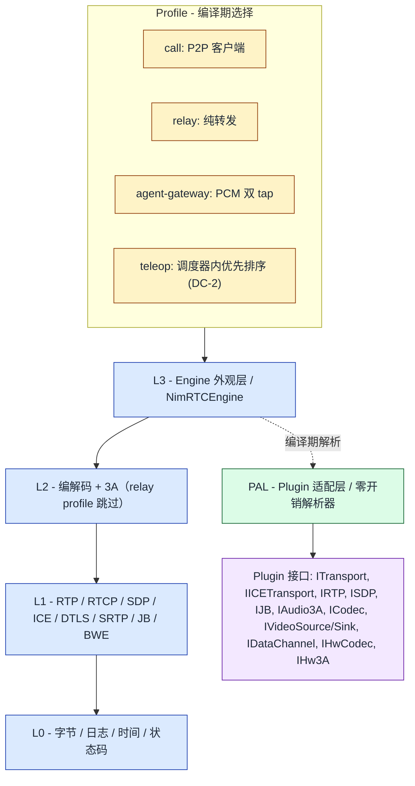

# NimRTC

[](LICENSE)
[](CHANGELOG.md)
[](https://en.cppreference.com/w/cpp/20)
[](#平台支持)
[](#构建--ci)
[](CONTRIBUTING.md)

> **最新发布版**：v1.0.2 稳定版 —— 补丁版，修复 WebTransport ALPN 不匹配与 Windows bundle 体积异常，并随发布附带签名公钥（`v1.0.1` 保持已发布且不变；`v1.0.0` 标签仅保留为源码里程碑，从未作为 GitHub Release 发布）。公共 API 按 ADR-015 冻结（`NIMRTC_API_VERSION` = 10002，`NIMRTC_API_VERSION_PRE_RELEASE` = `""`）。Chrome ↔ NimRTC 数据交换（DC-1）：走 Chrome WebTransport JS API（`new WebTransport(url)`，不是 `RTCPeerConnection.createDataChannel()`；标准 WebRTC DataChannel 互通未声称，Firefox/Safari 对 WebTransport 支持不完整）**PASS E1–E6**。
> 见 [CHANGELOG.md](CHANGELOG.md) `## [1.0.2]` 与 `docs/plan/v1.0-plan.md` §3 + §12.3.6。
>
> **当前 `main`（v1.0.2 之后，尚未发版）**：主干比已发布 tag 多出合并后的 **v1.1** 发布内容
> （原 v1.1 / v1.2 / v1.3 三份草稿合并为一个版本目标）：打包 + 基准轨、传输 / 媒体 / DTLS
> 加固轨，以及质量线的落地项（共享自适应抖动策略 `src/modules/jb_strategy`、简化版
> Goog-CC 风格 BWE（RTT + 丢包混合估计，**不是**完整 trendline 移植）、
> RTCP feedback 回环、引擎级 `ref_frame` / video stats、GMSSL 以 submodule 形式 vendor +
> SRTP 后端 seam、引擎源码拆分）。Windows/MSVC Debug 本地全套件 **651/651 PASS**（2026-11-04 实测）。
> 打包规则（`NIMRTC_INSTALL=ON` → `include/` + `lib/` + `lib/cmake/NimRTC/`）已在 `main` 落地，
> 下一个版本会带上；**已发布的 v1.0.2 bundle 里还没有**。
> 详见 [当前进度](#当前进度v102-已发布--main-领先) 与 [路线图](#路线图)。
>
> 📖 **本文档为英文 README 的中文版本**。技术 canonical 文档以 [`docs/zh/architecture.md`](docs/zh/architecture.md) 为准（ADR-012）。中文 README 与英文 README 内容同步维护。
>
> 🌐 **在线 demo**：[nimrtc.github.io/nimrtc/wasm](https://nimrtc.github.io/nimrtc/wasm/) —— 目前可访问的公开产物。

---

**原生 C++ WebRTC 替代实现 —— 可嵌入、场景化组装、后端可替换。**

一份源码同时产出 **P2P 客户端**、**`relay` 网关**，并能在 **嵌入式 Linux aarch64** 上跑。
DTLS / RTP / 3A 后端均通过 plugin 接口暴露，加密路径可切换到 **GMSSL**，在 GM/T 合规场景里
不 fork 主干。

> **术语说明**：本仓库产出的网关是 `relay` Profile —— 单策略转发 + 编译期 L2
> 编解码跳过（见 `docs/zh/architecture.md` §7.1）。**From-scratch 的 SFU 模块不是
> 交付内容**——SFU-1 / DC-3 / BENCH-1 在 §7 pre-1.0 决策窗口由 BDFL
> 关闭为 NO（2026-10-19，SFU 不是项目核心目标；见 `docs/plan/v1.0-plan.md`
> §7 + §12.5）。`profiles/sfu.json` 与 `profiles/sfu-agent.json` 仍留在仓库里，
> 但它们是**未注册**的 JSON：带 `sfu_enabled` 标记与 `sfu-relay` 传输策略，
> 没有对应的 `kProfileSfu` 常量，也不属于已交付 Profile 集合。

[为什么选 NimRTC？](#为什么选-nimrtc) · [适用人群](#适用人群) · [快速上手](#快速上手) · [Hello, World](#hello-world) · [架构概览](#架构概览) · [基准数据](#基准数据) · [路线图](#路线图) · [常见问题](#常见问题)

---

## 为什么是现在？

WebRTC 在演进，但主流实现没跟上。

- **libwebrtc** 是事实标准引擎，但构建产物多 GB、加密和编解码都是黑盒、代码库是 monolithic 的。
  把 libwebrtc 嵌到 aarch64 上，或者按 GM/T 合规要求去做审计，本身就是一场苦修。
- **AI Agent / 遥操作 / 具身智能机器人**需要 libwebrtc 不暴露的能力 —— pre/post-3A PCM tap、调度器内严格优先排序（DC-2，见 `sched.hpp` Scope note；默认 `web_transport` 后端下不是跨连接线端保证）、采集-决策帧对齐 API。
- **信创 / 合规**环境要的是"换路径"而不是"fork 主干"的国密落地方式。

NimRTC 是从零用 C++20 写的实现：保留你需要的**线缆级互通**（已在 Chrome 上验证，
覆盖媒体（Case D）与数据（Case E，走 WebTransport JS API）两条路径），把不透明的单体替换成**编译期分层 + plugin 适配**的引擎，可读、可换、可上 aarch64。

---

## 一句话总结

- **是什么**：一个可嵌入的 C++20 媒体引擎，从零开始实现的 WebRTC 替代品，**不是** libwebrtc 的 fork。
- **存在的原因**：libwebrtc 体积庞大、难以嵌入、加密和编解码不透明。NimRTC 保留同等级协议兼容性的同时，把 monolith 替换成分层 + plugin 适配的引擎，可被检查、可被定制、可被部署在 aarch64 上。
- **当前状态**：**v1.0.2 是最新已发布版本**（稳定版）。`main` 主干在 v1.0.2 之后、尚未发版，
  上面挂着一条合并后的 **v1.1** 轨道（原 v1.1 / v1.2 / v1.3 三份草稿合并为一个版本目标）：
  - **v1.1 —— 质量 + 打包 + 加固 + 质量线**：可复现的传输层基线（`tools/benchmark_latency.py`、
    `tools/benchmark_dc.py`）并产出 CI artifact；`NIMRTC_INSTALL=ON` 安装规则产出
    `include/` + `lib/` + `lib/cmake/NimRTC/`，装完即可 `find_package(NimRTC)`；WebRTC APM
    预编译产物随包一起安装；传输栈残留（`ISctpSocket` 生命周期、ICE `last_recv_packet()`
    收包分流、统一 `make_transport_instance()`、p99 策略校验器、非标视频时钟率协商、
    DTLS IPv6 `set_peer()`、NAT rebinding `rehandshake()`）；质量线（RFC 3550 抖动估计与
    "base + 4·J" 目标延迟策略现在**只实现一份**，放在 `src/modules/jb_strategy`，音频（`jb`）
    与视频（`video_jb`）两个前端共用，视频侧自适应播放通过
    `EngineConfig::video_receiver_tuning.adaptive_playout` 开关启用；另有简化版 Goog-CC 风格 BWE
    （RTT + 丢包混合估计，**不是**完整 trendline 移植）、
    RTCP feedback 回环、引擎级 `ref_frame` / video stats、GMSSL 以 submodule 形式 vendor、
    SRTP 后端 seam、引擎源码拆分）。
  公共 API 按 ADR-015 冻结（`NIMRTC_API_VERSION` = 10002），破坏性变更需要 MINOR/MAJOR 版本号。
  Windows/MSVC Debug 本地全套件 **651/651 PASS**。
  **In-process SFU relay（`nimrtc_sfu`）、DC 转发策略（DC-3）、`sfu-relay` 基准（BENCH-1）
  已于 2026-10-19 关闭为 NO，仍不在关键路径上**（见 `docs/plan/v1.0-plan.md` §7，SFU 不是项目核心目标）。

---

## 特性一览

| | | |
|---|---|---|
| 🎯 **编译期分层（L0–L3）** | 🔌 **公开 plugin 接口** | 🪶 **12.55 MB 静态库**（libwebrtc 150–250 MB）|
| 🧩 **面向场景的 Profile，不 fork 主干** —— `call` / `transport` / `relay` / `agent` / `agent-gateway` / `agent-low-latency` / `relay-agent` / `teleop` / `live` | 🔁 **DTLS 后端可替换** —— wolfSSL（默认）↔ GMSSL（opt-in），API 不变 | 🛡️ **GM/T 国密路径** —— DTLS/TLCP 走 GMSSL（SRTP 仍为国际套件） |
| 📡 **线缆级互通** —— Chrome（媒体 + WebTransport DataChannel） | 🏗️ **四平台 CI** —— Win / Linux x86_64 / macOS arm64 / Linux aarch64 | 🎛️ **面向 AI Agent 的差异化** —— pre/post-3A PCM tap、ref_frame 时间线 |

---

## 为什么选 NimRTC？

下面这些**单点都不新**，但**组合在一起**在 2026 年的开源 WebRTC 生态里是少见的：

| # | 差异化点 | 为什么重要 |
|---|---|---|
| 1 | **分层 + Profile 组装（L0–L3）** | 编译期选层。同一份代码既能发 P2P 客户端，也能发 `relay` 网关（`relay` profile 跳过 L2 编解码，见 `docs/zh/architecture.md` §7.1）。**注意**：from-scratch 的 SFU 模块不是交付内容（§7 pre-1.0 决策窗口在 2026-10-19 由 BDFL 关闭为 NO，SFU 不是项目核心目标；见 `docs/plan/v1.0-plan.md` §7 + §12.5）。LiveKit/mediasoup 只做服务端；libwebrtc 是 monolithic。 |
| 2 | **多平台 CI 全部绿色** | Windows / Linux x86_64 / macOS arm64 / Linux aarch64 四平台均通过构建+单测。详见[平台支持](#平台支持)。 |
| 3 | **PAL（Plugin Adaptation Layer）** | 所有能力切换走 `pal::*`，**零运行时开销**，公共 API 不变。详见 [ADR-009](docs/adr/ADR-009-pal-slice-1.md)。 |
| 4 | **DTLS 后端可替换** | DTLS 后端是 plugin：wolfSSL（默认）或 GMSSL，通过 `EngineConfig::dtls_name` 切换，公共 API 不动。多数开源 WebRTC 栈把加密焊死。（mbedTLS 是最初的 DTLS 后端，现在只作为归档源码保留，**不再链接进产物**。） |
| 5 | **P2P 客户端和 relay 同一 codebase** | 同一套 plugin 接口同时支撑两条产品线。2026 年的开源 WebRTC 生态里几乎找不到第二家。（from-scratch 的 SFU 模块不是项目核心目标 —— 见 `docs/plan/v1.0-plan.md` §7，BDFL 2026-10-19。） |

> **plugin 接口是这套架构的"接缝"**。上面五点要组合起来才出差异化，详见 [§ plugin 架构](#plugin-架构)。

---

## 适用人群

| 如果你是… | NimRTC 能帮你… |
|---|---|
| 用 C++ 写 P2P 语音/视频应用 | 用一个真正能 `grep`、能静态链接、几个 MB 就够的引擎替代 libwebrtc。 |
| 政企信创 / 国密合规环境 | 不 fork 主干就把 DTLS 加密切换到 GMSSL（TLCP / SM2 / SM3 / SM4）。**范围说明**：国密路径覆盖 DTLS 握手 —— SRTP 仍使用国际 AES 套件（SM4-GCM SRTP 在后续版本）。 |
| 在嵌入式 Linux aarch64 上跑 | Raspberry Pi、工业 SBC、机器人主控 —— 同一 codebase，桌面端能用的能力嵌入式也能用。 |
| 搭 AI Agent / 遥操作 / 具身智能机器人 | 用 pre/post-3A 双 PCM tap、调度器内严格优先排序（DC-2 范围声明适用）、ref_frame 时间线 API。 |
| 自建 relay 但不想重写协议栈 | 编译 `relay` profile（L0+L1+L3），同一套引擎，跳过 L2 codec。 |

> **不适用的场景**：今天就要一个开箱即用的浏览器级 SDK；只做移动端（iOS/Android 在路线图，不在当前轨道）。

---

## 下载预编译包（v1.0.2）

每个平台的 bundle 都包含该平台**vendored 第三方依赖栈**——wolfSSL / libsrtp3 / libjuice /
msquic 的头文件与库——你可以直接检视并链接引擎所用的同一套 crypto、SRTP、ICE、QUIC 原语，
不必自己先编译一遍。

> **v1.0.2 的 bundle 里还没有 NimRTC 自己的头文件、静态库和 `NimRTCConfig.cmake`。**
> 因此从下载的 v1.0.2 bundle 里 `find_package(NimRTC)` 还用不了，链接 NimRTC 本身
> 仍需从源码构建（见下方[快速上手](#快速上手)）。这一点已在 `main` 上修好：
> `NIMRTC_INSTALL=ON` 现在会产出 `include/` + `lib/` + `lib/cmake/NimRTC/`
> （Windows 下游已验证），下一个版本会带上。

> **v1.0.2 的 bundle 里也没有 WebRTC APM 归档**：四个 tarball 里都不存在
> `lib/webrtc_apm/` 目录，所以下载到的 bundle 完全不带音频 3A。发布说明里的
> 逐平台 3A 状态因此写作"构建用的是真实 WebRTC APM，但该 bundle 不含 APM 归档"；
> 这些归档由 `main` 的安装规则产出，会在下一个版本里出现。

- Release 页面：[v1.0.2](https://github.com/NimRTC/nimrtc/releases/tag/v1.0.2)
- 资产：`nimrtc-1.0.2-<platform>.tar.xz` + `.sha256` + `.asc`（含 `sbom.json`）

```bash
tar -xJf nimrtc-1.0.2-linux-x86_64-gcc.tar.xz
sha256sum -c nimrtc-1.0.2-linux-x86_64-gcc.tar.xz.sha256
gpg --verify nimrtc-1.0.2-linux-x86_64-gcc.tar.xz.asc
```

签名公钥指纹：`114154CFEC3F5EE5A8D2D313BEACFBB55871CC06`。

---

## 快速上手

### 前置依赖

- **CMake ≥ 3.25**
- **MSVC 19.43+**（Windows 10/11）· **GCC 11+ / Clang 12+**（Linux）· **Apple Clang 15+**（macOS 14+）
- **Ninja**（推荐）
- **Python 3.8+**（e2e 自动化需要）

校验工具链：

```bash
python tools/check_prerequisites.py
```

### Clone

```bash
git clone --recurse-submodules https://github.com/NimRTC/nimrtc.git
cd nimrtc
```

### 构建（A：交互脚本）

```bat
:: Windows
.\scripts\build.bat
.\scripts\build.bat --release     :: Release 配置
```

```bash
# Linux / macOS
bash scripts/build.sh
bash scripts/build.sh --preset=release
```

### 构建（B：手动 CMake）

```bash
cmake --preset debug            # 可选：debug.msvc / release.msvc / debug.aarch64 等
cmake --build build --config Debug -j
```

> **预设说明**：详见 [`CMakePresets.json`](CMakePresets.json)。`dev.*` 系列为 hidden 父预设，命令行请用可见预设（`debug.msvc` / `release.msvc` / `debug.aarch64` 等）。

### 跑测试

```bash
ctest --preset tests --output-on-failure
```

### 跑 loopback-p2p 冒烟测试

两个进程内 agent 通过真实 UDP 握手，不需要信令服务器。

```bash
cmake -B build -DNIMRTC_BUILD_EXAMPLES=ON -DCMAKE_BUILD_TYPE=Debug
cmake --build build --target loopback-p2p
./build/examples/Debug/loopback-p2p        # Windows 下加 .exe
```

### 跑 Chrome 互通验收

```bash
python tools/run_e2e_acceptance.py
ls build/e2e/        # 产物落地路径
```

> **首次构建提示**：所有第三方依赖通过 git submodule + SHA 锁定（`src/third_party/vendor.json`），clone 时加 `--recurse-submodules` 一并拉取。

---

## Hello, World

两个 engine 走完 SDP 协商，在 loopback 接口上跑通 ICE 连通性检查，最终双双进入 `connected`
—— **~30 行 C++**。这就是 `examples/loopback-p2p/` 里的同款代码路径：

```cpp
#include <nimrtc/engine/engine.hpp>
#include <thread>
#include <chrono>

using namespace nimrtc::engine;
using namespace std::chrono_literals;

int main() {
    EngineConfig cfg;
    cfg.local_bind_address    = "127.0.0.1";
    // local_port_range_begin / _end 保持 0：由操作系统分配临时端口，
    // 两个 engine 各自独占一个 socket，不会互相抢端口。
    cfg.pcm_sample_rate_hz     = 48000;
    cfg.pcm_channels           = 1;

    // Offerer（CONTROLLING）
    NimRTCEngine A(cfg);
    A.pre_open();
    A.open();
    auto offer = A.create_offer();

    // Answerer（CONTROLLED）—— 先塞远端 ICE，让 libjuice 选对角色
    NimRTCEngine B(cfg);
    B.pre_open();
    B.set_remote_ice(extract_ice_block(offer));   // 辅助函数，参考 examples/
    B.open();
    auto answer = B.process_remote_sdp(offer);

    A.process_remote_sdp(*answer);

    // 双边 tick，直到 ICE 都连通
    while (A.ice_state_string() != "connected" || B.ice_state_string() != "connected") {
        A.tick();
        B.tick();
        std::this_thread::sleep_for(10ms);
    }
    return 0;
}
```

三件事值得注意：

1. **没有 mock 对象、没有测试框架** —— engine 通过真实 UDP 在 `127.0.0.1` 上跟自己握手。
   你应用里用的就是这个 `NimRTCEngine`，没有"另一套测试 API"。
2. **DTLS / SRTP / RTP / 抖动缓冲 / ICE** 都在 `tick()` 内部处理，用户代码看不到任何协议状态。
3. **plugin 接口不会泄漏到应用层**。后续要把 wolfSSL 换成 GMSSL，或把自研 3A 换成 HW 后端，
   上面这段代码**不需要改**。

完整源码：[`examples/loopback-p2p/loopback-p2p.cpp`](examples/loopback-p2p/loopback-p2p.cpp)。
Chrome 互通（Chrome 出 offer，NimRTC 出 answer，SDP↔ICE 手动桥接）见 [`interop/`](interop/)
和 [`tools/run_e2e_acceptance.py`](tools/run_e2e_acceptance.py)。

---

## 架构概览

NimRTC 是 **L0–L3 四层编译期叠加 PAL（Plugin Adaptation Layer）**。**Profile** 也是编译期决定
哪些层会被链接进二进制——同一份源码既能产出 P2P 客户端，又能产出 `relay` 网关（`relay`
profile 跳过 L2 编解码，见 `docs/zh/architecture.md` §7.1），原理就在这里。
**From-scratch 的 SFU 模块不是交付内容** —— §7 pre-1.0 决策窗口
已由 BDFL 关闭为 NO（2026-10-19，SFU 不是项目核心目标；见 `docs/plan/v1.0-plan.md` §7 + §12.5）。

### 分层一览

```
            ┌──────────────────────────────────────────────────┐
            │  PROFILE  ——  编译期选择                          │
            │  call（P2P）│ transport │ relay │ agent │        │
            │  agent-gateway │ agent-low-latency │ teleop │ live│
            └──────────────────────────────────────────────────┘
                                    │
                                    ▼
            ┌──────────────────────────────────────────────────┐
            │  L3  Engine 外观层                                │
            │  NimRTCEngine 把所选 profile + plugin 串起来       │
            └──────────────────────────────────────────────────┘
                                    │
                                    ▼
            ┌──────────────────────────────────────────────────┐
            │  L2  编解码 + 3A         （relay profile 跳过）     │
            │  Opus / G.711 / VP8 / H.264 / H.265 / AV1 · 音频 3A 流水线 │
            └──────────────────────────────────────────────────┘
                                    │
                                    ▼
            ┌──────────────────────────────────────────────────┐
            │  L1  协议 / 状态机                                │
            │  RTP · RTCP · SDP · ICE · DTLS · SRTP · JB · BWE  │
            └──────────────────────────────────────────────────┘
                                    │
                                    ▼
            ┌──────────────────────────────────────────────────┐
            │  L0  原语                                          │
            │  字节 · 日志 · 时间 · 状态码                        │
            └──────────────────────────────────────────────────┘

       ┌──────────────────────────────────────────────────────┐
       │  PAL  ——  Plugin 适配层                              │
       │  每个能力都在编译期解析完，零运行期间接，公开 API 不变 │
       └──────────────────────────────────────────────────────┘
                                    │
                                    ▼
       ┌──────────────────────────────────────────────────────┐
       │  PLUGIN 接口  （header-only，在 `src/plugins/`）       │
       │                                                       │
       │  ITransport · IICETransport · IRTP · ISDP · IJB       │
       │  IAudio3A · ICodec                                    │
       │  IVideoSource · IVideoSink · IDataChannel             │
       │  IHwCodec · IHw3A                                     │
       └──────────────────────────────────────────────────────┘
```

GitHub 原生渲染版本：



### 各层职责

| 层 | 所在位置 | 职责 |
|---|---|---|
| **Profile** | `cmake/profiles/*.cmake` | 纯构建期选择：决定 L0–L3 哪些被链接、Plugin 走哪一套后端。**没有运行期分发**——选 `relay` 就是在构建时把 L2 整个砍掉。 |
| **L3 Engine** | `src/engine/` | 唯一对外门面（`NimRTCEngine`）。把 Plugin 串起来；公开 API 里**不出现任何具体模块头文件**——见 [`ARCHITECTURE.md`](ARCHITECTURE.md) 的 Layout Invariant 4。 |
| **L2 编解码 + 3A** | `src/modules/opus/`、`…/audio3a/`、`…/video_payload/` | 编解码与音频 3A 流水线。`relay` profile 不编 L2，二进制里编码面直接砍半。 |
| **L1 协议 / 状态机** | `src/modules/{rtp,sdp,ice,dtls,srtp,jb,bwe}/` | 真正跟网络打交道的那一层。按 §11 vendoring 规则**自研**，不引入第三方协议栈。 |
| **L0 原语** | `src/core/`、`src/log/` | 状态码、字节缓冲、单调时钟、日志。能 header-only 就 header-only。 |
| **PAL** | `src/plugins/pal/` | 用一个小注册表把每个 Plugin 能力在编译期解析完；解析之后调用是直接的，零间接，对 Engine 来说公开 API 完全不变。见 [ADR-009](docs/adr/ADR-009-pal-slice-1.md)。 |
| **Plugin 接口** | `src/plugins/` | Header-only 的抽象基类——这就是那道**缝**。OpenSSL ↔ mbedTLS ↔ GMSSL、自研 ↔ HW 3A、libjuice ↔ 自研 ICE，全部通过这一层接口替换。 |

### 数据流（一段话版）

一帧从 `IVideoSource`（或麦克风采集）进来，L1 做 RTP 打包，下到 `ITransport`，由
`IDTLS`/`ISRTP` 在线缆上做保护。接收端走反方向：`ITransport` → 抖动缓冲（`IJB`）→ L2 解码
→ 音频 3A（`IAudio3A`）→ `IVideoSink` / 音频渲染。BWE 通过 RTCP 回环收紧带宽估计。L0 之上
的全部都能通过 Plugin 接口替换——所以不 fork 就能切到 GMSSL 或 HW 3A 后端，改一个 CMake
选项即可。

详细设计：见 [`docs/zh/architecture.md`](docs/zh/architecture.md)（canonical，中文）。

---

## 基准数据

选 NimRTC 而不是 libwebrtc 的头号理由是**体积**——二进制 footprint 和源码复杂度。

### 二进制体积（Windows x86_64，MSVC，Release）

| 产物 | NimRTC | libwebrtc（参考） |
|---|---|---|
| 静态库 `nimrtc_engine` | **12.55 MB** | 150–250 MB |
| 示例 `loopback-p2p`（完整客户端） | **2.42 MB** | 50–80 MB（典型 WebRTC sample） |
| 示例 `demo-p2p` | **2.46 MB** | — |
| **预估静态链接 footprint** | **~22.4 MB** | **~100 MB 起** |

> 实测环境：Windows 10 x86_64，MSVC，Release（本地 `build/`，`nimrtc_engine.lib` 13,164,084 字节 = 12.55 MB；示例二进制取自 `build/examples/Release/`）。改构建选项后跑 `python tools/benchmark_size.py build --markdown` 更新。
>
> **注**：单是静态库就有 12.55 MB；GitHub About 页和旧文档里写的 "~5.6 MB" 是更早那套模块集合的
> 数字，对应的是旧构建。About 页现已改为 ~12.6 MB，与上面的实测值一致。

本地复现：

```bash
cmake --preset release.msvc -DNIMRTC_BUILD_EXAMPLES=ON
cmake --build build --config Release -j
python tools/benchmark_size.py build --markdown   # 可直接粘贴 README 的表格
```

### 源码规模

| 项目 | 源码行数 | 主语言 |
|---|---|---|
| **NimRTC** | ~30 K（含 vendored） | C++20 |
| libwebrtc | ~5.5 M | C++（混 C++03/11/14/17）+ 内部绑定 |

> 行数通过 `cloc` 估算（不含 vendored 依赖）。libwebrtc 的数字是广泛引用的公开估值，会随平台 / branch 浮动。

### 这意味着什么

- **可嵌入** —— 链接进你的宿主应用只需几 MB，而不是 100+ MB 的整块。
- **可审查** —— 整个引擎源码可以 `grep` 通。安全修复、等保评审、合规审计对比 libwebrtc 是可完成的。
- **笔记本能构建** —— NimRTC 全量构建在普通笔记本上几分钟。libwebrtc 仅源码拉取就要 GB 级。
- **嵌入式友好** —— aarch64 加 `-Os` 后链接 footprint 更小；libwebrtc 几乎只部署在 x86_64 / arm64 服务器上。

### 注意事项

- libwebrtc 数字是**公开参考值**，随平台、branch、codec 集合浮动，发布营销文案前请重新验证。
- NimRTC 数字取决于构建选项（`-DNIMRTC_PLUGINS_NVENC=ON` 等）。每次改选项都跑一遍 `benchmark_size.py`。

### 传输层基线（本机 UDP 回环，v1.1）

Track A 基线是传输层下限数字，不是引擎端到端声明。Windows 10 x86_64 本地 `build/` 典型区间（回环数字随机器与负载浮动）：

| 基准 | 载荷 | 典型区间 |
|---|---|---|
| `bench_latency.json`（1000 × 172 B 回显） | 172 B（约 20ms Opus 单声道 + RTP 头） | p50 **~10 µs**，p99 **~20–35 µs**，平均抖动 **<1 µs** |
| `bench_dc.json` datagram 平面（2000 包） | 256 B | **~60–80k pps / ~120–165 Mbps** |
| `bench_dc.json` datagram 平面（2000 包） | 1200 B | **~60–80k pps / ~570–800 Mbps** |
| `bench_dc.json` bidi-stream-chunk 平面（2000 包） | 16384 B | **~60–70k pps / ~8–9 Gbps** |
| `bench_weaknet.json` loss-5pct 档（200 × 1200 B） | 1200 B，5% 丢包 + 5 ms 基准 | 送达率 **~0.95**，p50 **~5–7 ms**，p99 **~5–8 ms** |
| `bench_weaknet.json` jitter-100ms 档（200 × 1200 B） | 1200 B，20 ms 基准 + 0–100 ms 抖动 | 送达率 **1.0**，p50 **~74–76 ms**，p99 **~118–121 ms** |
| `bench_weaknet.json` cap-1mbps 档（200 × 1200 B） | 1200 B，1 Mbps 整形 + 5 ms 基准 | 送达率 **1.0**，p50 **~15–17 ms**，p99 **~19–31 ms** |
| `bench_weaknet_netem.json` loss-5pct 档（200 × 1200 B，Linux） | 1200 B，5% 丢包 + 5 ms 基准 | 送达率 **~0.94–0.95**，p50 **~5.1 ms**，p99 **~5.2 ms** |
| `bench_weaknet_netem.json` jitter-100ms 档（200 × 1200 B，Linux） | 1200 B，20 ms 基准 + 0–100 ms 抖动 | 送达率 **1.0**，p50 **~68 ms**，p99 **~118 ms** |
| `bench_weaknet_netem.json` cap-1mbps 档（200 × 1200 B，Linux） | 1200 B，1 Mbps 整形 + 5 ms 基准 | 送达率 **1.0**，p50 **~15.1 ms**，p99 **~15.2 ms** |

> 用 `python tools/benchmark_latency.py --count 1000`、`python tools/benchmark_dc.py` 与 `python tools/benchmark_weaknet.py --count 200 --size 1200` 复现；产物落在 `build/e2e/bench_latency.json` + `build/e2e/bench_dc.json` + `build/e2e/bench_weaknet.json`。具体数字随机器与负载浮动——已落盘 JSON 只是一次本地采样，不是通过/失败阈值。弱网三档走本机 UDP 回环上的进程内整形器（确定性种子损伤），无需 root 即可复现；Linux 上对应的 `tc qdisc netem` 版本是 [`tools/benchmark_weaknet_netem.sh`](tools/benchmark_weaknet_netem.sh)（需要 root + iproute2），产物落在 `build/e2e/bench_weaknet_netem.json`。限速档的发送速率被压到容量的 90%，且读数包含链路的序列化时间，所以上表是链路自身的延迟，而不是发送方自己堆出来的队列。引擎端到端延迟 / 抖动 / MOS 仍依赖平台、codec、网络与目标场景——等 P2（PCM tap）与 P3（BWE + ref_frame）落地后再发布 profile 专属 benchmark。

详见 [`tools/benchmark_size.py`](tools/benchmark_size.py)、[`tools/benchmark_latency.py`](tools/benchmark_latency.py)、[`tools/benchmark_dc.py`](tools/benchmark_dc.py)、[`tools/benchmark_weaknet.py`](tools/benchmark_weaknet.py) 与 [`tools/benchmark_weaknet_netem.sh`](tools/benchmark_weaknet_netem.sh)。

---

## plugin 架构

NimRTC 几乎所有"可替换"的能力都通过 plugin 接口暴露（[`src/plugins/include/nimrtc/plugins/*.hpp`](src/plugins/include/nimrtc/plugins/)，[ADR-001](docs/adr/ADR-001-plugin-system.md)）。Engine 通过 PAL（[ADR-009](docs/adr/ADR-009-pal-slice-1.md)）解析。

| 维度 | 显式 plugin 接口的价值 | 不做 plugin 接口的代价 |
|---|---|---|
| **后端替换** | ICE ↔ QUIC transport、RTP 调试器、3A 旁路 —— 同一份 engine 代码切换 | 每个后端都要 fork engine，违反 OCP |
| **测试隔离** | 测试用 `MockTransport` / `NullAudio3A` / `CountingJitterBuffer` 注入，不需要 mock framework | gmock / virtual mock 类污染生产代码 |
| **企业版插桩** | 国密 DTLS、3A 旁路、SLA 监控 —— 企版编译时**仅替换 plugin 实现**，核心仓主干不分裂 | 企版 fork 主干（漂移）或 `#ifdef`（不可维护） |
| **第三方生态** | 写 `MyAudio3A : plugins::IAudio3A`，`-DNIMRTC_MODULE_AUDIO3A=MyAudio3A` 注入 | 用户必须 `#include <nimrtc/audio3a/...>` 才能扩展，破坏封装 |
| **故障域隔离** | plugin 接口 status code 是契约 | 错误码五花八门，跨模块失败原因追踪极其痛苦 |

**对比基线**：GStreamer / FFmpeg / OBS / PipeWire 都用 plugin 架构，但那是多媒体生态；**WebRTC 生态**里（libwebrtc / Pion / LiveKit / mediasoup / janus）只有 Pion 和 libwebrtc 内部有类似抽象。**NimRTC 把 plugin 接口公开，且让 P2P 客户端和 `relay` 网关跑在同一套接口上**（`relay` profile 跳过 L2 编解码；from-scratch 的 SFU 模块不是交付内容 —— 见 `docs/plan/v1.0-plan.md` §7）——2026 年的开源 WebRTC 生态里几乎找不到第二家。

Plugin 是 NimRTC **可演进性**的核心机制：P0–P1 用内置实现，P2–P3 引入的差异化能力（双 3A tap、调度器内严格优先排序、ref_frame）也以 plugin 形式呈现（P2 `IJB::set_render_delivered`、P3 `IRTP::set_ref_frame`）。

---

## 与同类项目的对比

给评估者的实用矩阵 —— 横向对比你关心的那几行：

| | **NimRTC** | **libwebrtc** | **Pion** | **mediasoup** | **LiveKit** |
|---|---|---|---|---|---|
| **语言** | C++20 | C++（混 C++03/17） | Go | C++ | Go |
| **同一 codebase 产出 P2P + relay** | ✅ | ⚠️ libwebrtc + 独立 server | ❌ | ❌ 仅 SFU | ❌ 仅 SFU |
| **公开 plugin 接口** | ✅ 各层都有 | ❌ 内部封装 | ⚠️ 部分 | ⚠️ 服务端 | ⚠️ 服务端 |
| **静态链接 footprint** | **12.55 MB** | 150–250 MB | 不适用（Go） | 服务端 | 服务端 |
| **嵌入式 Linux aarch64** | ✅ CI 绿色 | ⚠️ 久未维护的 port | ❌ | ❌ | ❌ |
| **GM/T 国密（GMSSL）后端切换** | ✅ plugin 切换，不 fork（DTLS 层） | ❌ 需打补丁重建 | ❌ | ❌ | ❌ |
| **AI Agent / 3A 旁路 hook** | ✅ `pre/post-3a` PCM tap（P2） | ❌ APM 黑盒 | ❌ | ❌ | ❌ |
| **ref_frame / 帧对齐时间线** | 🚧 P3 | ❌ | ❌ | ❌ | ❌ |
| **线缆级 Chrome 互通** | ✅ Case D 绿色（媒体）+ Case E 绿色（WebTransport DataChannel） | ✅ | ✅（仅 Go） | ✅ 通过浏览器 SDK | ✅ 通过浏览器 SDK |
| **2026 生产成熟度** | Stable（v1.0.2 已发布） | Production-grade | Production-grade | Production-grade | Production-grade |

**NimRTC 全面领先的领域**：aarch64 嵌入式、GM/T 国密路径（DTLS 层）、AI Agent hook、单主干 P2P+relay（`relay` 是单策略网关 profile，编译期跳过 L2 编解码；from-scratch 的 SFU 模块不是交付内容 —— 见 `docs/plan/v1.0-plan.md` §7，BDFL 2026-10-19）。
**NimRTC 落后的领域**：生态广度、编解码覆盖、浏览器引擎对等、年限沉淀。**按需选择。**

---

## Profile

Profile 是**编译期配置**，不是运行时分发。声明式 JSON 格式见 [ADR-010](docs/adr/ADR-010-profile-json-format.md)。

| Profile | 包含层 | 用途 |
|---|---|---|
| `call` | L0+L1+L2+L3 | 1:1 双向语音/视频通话 —— 默认 P2P 客户端（Chrome 互通） |
| `transport` | L0+L1+L3（**跳过 L2**）| 嵌入式 ICE/DTLS-SRTP 网关 —— 纯透传，不做媒体处理 |
| `relay` | L0+L1+L3（**跳过 L2**）| 服务器转发，不重编解码 |
| `agent` | L0+L1+L2+L3 | AI Agent SDK（语音/文本 1:1）—— timeline + DC |
| `agent-gateway` | L0+L1+L2（tap 打开）| AI Agent 接入，PCM 双 tap + 3A 旁路 |
| `agent-low-latency` | L0+L1+L2+L3 | 延迟优先的 Agent 链路（20 ms JB、关闭 AGC） |
| `relay-agent` | L0+L1+L3 | relay + AI Agent 混合（N:1），timeline 重新校准 |
| `teleop` | L0+L1+L2+L3 | 机器人 / 具身智能遥操作 —— 调度器内严格优先排序 (DC-2 范围声明适用) |
| `live` | L0+L1+L2+L3 | 单向直播 / 广播 |

> 完整矩阵（**已交付的 9 个 Profile**，含 JB / 3A / BWE / DC 逐字段取值）见
> [`docs/profiles.md`](docs/profiles.md)。`cloudgame`（云渲染 / 云游戏串流）是
> **长线候选，不在已交付 Profile 集合内** —— 见
> [`docs/plan/v1.1-plan.md`](docs/plan/v1.1-plan.md) §2 Track V。
>
> `profiles/` 目录下另有两份**未注册**的 JSON：`sfu.json` 与 `sfu-agent.json`。
> 它们带 `sfu_enabled` 标记与 `sfu-relay` 传输策略，但没有对应的 `kProfileSfu` 常量，
> 不属于已交付 Profile 集合 —— from-scratch 的 SFU 模块已于 2026-10-19 关闭为 NO
> （见 `docs/plan/v1.0-plan.md` §7）。

---

## 差异化能力（针对 AI Agent / 遥操作 / 嵌入式）

这三项是 **P2 / P3 的目标交付**，不是 P0 已具备 —— 列在这里便于提前规划。

| 需求 | NimRTC 差异化 | 当前同类项目状态 |
|---|---|---|
| **3A 旁路**：Agent 需要把语音喂给 ASR | `pre-3a / post-3a` **双 PCM tap** 原语 | WebRTC APM 黑盒，PCM 中段无 hook |
| **同一 Scheduler 内的控制与媒体排序**：同队列排序，不是跨连接抢占 | DC-2 严格优先排序仅适用于进入同一 `Scheduler` 实例的包。默认 `web_transport` 后端下，媒体（Case D，DTLS-SRTP over ICE/UDP）与数据（Case E，WebTransport over QUIC）是**两条独立连接、各自拥塞控制**，线端上不存在跨平面优先调度。只有 legacy `"sctp"` 后端把两个平面放在同一连接上，调度器内排序才接近线端意义。见 `src/modules/sched/include/nimrtc/sched/sched.hpp` § Scope note | DTLS-SCTP / DataChannel 仅尽力而为 |
| **采集-决策对齐**：AI Agent 决策要与视频帧关联 | `ref_frame` 时间线 API | libwebrtc 无此抽象，application 层必须自建 |

---

## 路线图

项目现在按**版本化轨道**推进，而不是旧的 P1–P4 阶梯。权威计划文档是 `docs/plan/v1.*-plan.md`。

| 版本 | 定位 | 范围 | 状态 |
|---|---|---|---|
| **v1.0.x** | Stable | WebTransport / msquic 数据面（DC-1）、调度器内排序（DC-2）、Chrome e2e Case D + E | ✅ **v1.0.2 已发布** 2026-11-03 |
| **v1.1** | 质量 + 打包 + 加固 + 质量线 | 可复现的传输层基线并产出 CI artifact；安装规则 + `NimRTCConfig.cmake`，让 `find_package(NimRTC)` 在安装树里可用；APM 预编译产物随包发布；发布加固（签名 tag、四平台 release 腿）；传输栈残留（`ISctpSocket` 生命周期、ICE `last_recv_packet()` 分流、统一 `make_transport_instance()`、ARQ tech-preview 标注）；媒体/RTP（SDP `a=rtpmap` 视频时钟率、p99 策略校验器）；DTLS P2（IPv6 `set_peer()`、NAT rebinding `rehandshake()`、pump 重入保护）；弱网质量链（简化版 Goog-CC 风格 BWE、统一自适应 JB、RTCP feedback 回环、netem 弱网基线）；`ref_frame` 与指令-帧 API 提升到引擎公开面；引擎级 video stats；GMSSL 以 submodule 形式 vendor + SRTP 后端 seam；引擎源码拆分 | 🟡 已落地在 `main`，等待发布加固门禁 |
| **v1.2+** | — | SM4-GCM SRTP 实现、`cloudgame`（长线候选）、`takeover`（远程车辆接管，P4） | ⏸️ 规划中 |
| — | 已关闭 | 进程内 SFU 模块（`nimrtc_sfu`）、DC 转发策略（DC-3）、`sfu-relay` 基准（BENCH-1） | ❌ **NO** —— 2026-10-19 关闭，BDFL：SFU 不是项目核心目标（`docs/plan/v1.0-plan.md` §7） |

完整路线图：[`docs/zh/architecture.md`](docs/zh/architecture.md) §13 ·
[`docs/plan/v1.1-plan.md`](docs/plan/v1.1-plan.md)。

---

## 当前进度（v1.0.2 已发布 —— main 领先）

今天就能用的能力。下表覆盖**截至 v1.0.2（含）**已发布的内容；表后的段落列出
**已落地在 `main` 但尚未发版**的工作。Windows/MSVC Debug 对标准构建实测：**651/651 PASS**
（2026-11-04；构建里不含真实 WebRTC APM 时有 3 个用例 skip）。

| 能力 | 状态 | 落地版本 |
|---|---|---|
| v0.10 设计 + ADR 决策落地（ADR-009 / 010 / 011 / 012） | ✅ | v0.10 |
| 脚手架 —— CMake、四平台 CI、vendored 依赖 | ✅ | v0.9.2 |
| 第三方库 vendor（wolfSSL / libsrtp / libopus / libjuice / WebRTC APM） | ✅ | v0.9.2 |
| Chrome ↔ NimRTC P2P 音视频互通（Case D，Windows） | ✅ | v0.9.2 |
| 四平台 CI 绿色 —— Win / Linux x86_64 / macOS arm64 / Linux aarch64 | ✅ | v0.9.2 |
| RFC 7587 Opus packetise / depacketise 完整实现 | ✅ | v0.9.2 |
| PAL Slice 1 —— plugin 能力解析，零运行时开销 | ✅ | v0.10 |
| PAL Slice 2 —— `kDefaultRegistrars[]` 自注册表 | ✅ | v0.10.1（在 v0.10.3 中追溯归位） |
| PAL Slice 3 —— `NIMRTC_PLUGIN_ID()` 编译期唯一 id 宏 | ✅ | v0.10.1（在 v0.10.3 中追溯归位） |
| PAL Slice 4 —— DTLS session 工厂走 registry hook（`get_dtls_session("wolfssl")`） | ✅ | v0.10.2 |
| PAL Slice 5 —— SCTP seam（`SctpStubFactory` id=`"stub"`）+ 接口 wire | ✅ | v0.10.2 |
| PAL Slice 6 —— Raw UDP bypass（`ArqRawUdp` id=`"arq"`）+ 4/4 真实回环测试 | ✅ | v0.10.2 |
| PAL Slice 7.5 —— `WebRtcClassicStackFactory`（id=`"webrtc-classic"`） | ✅ | v0.10.3 |
| PAL Slice 8 —— 4 个传输层 typed registry hook | ✅ | v0.10.2 |
| TAP-1 —— WebRTC APM 上的 PCM tap（`set_pre_process_tap` / `set_post_process_tap` + int16 ASR 变体） | ✅ | v0.11.0 |
| TPAL-4 收尾 —— `EngineConfig::dtls_name` 字段用于选择 DTLS 后端 | ✅ | v0.11.0 |
| PROFILE-1 —— 5 变体 Profile 库（`relay` / `transport` / `agent` / `agent-gateway` / `relay-agent`），JSON schema v1.0 为基准 | ✅ | v0.11.0 |
| Profile 回归 —— `JsonFileMatchesBuiltinConstant` 字段级相等测试，32 个子用例 | ✅ | v0.11.0 |
| DEMO-1 —— `demo-agent-gateway`（PCM tap → ASR/LLM mock，基于 `agent-gateway` Profile） | ✅ | v0.11.0 |
| DISC-1 —— GitHub Discussions 开启 | ✅ | v0.11.0 |
| RFC-1 —— RFC 001（PCM Tap）定稿 | ✅ | v0.11.0 |
| 五种命名传输栈（PAL Slice 7 / 7.6 / 8）+ Profile schema v1.1 + engine 集成 | ✅ | v0.12.0 |
| P1 UAF-DTLS 类型系统加固 + API 稳定性框架（ADR-015 冻结起点）+ PAL Slice 1.5 | ✅ | v1.0.0-alpha.1 |
| WebTransport / QUIC 选型（ADR-014）+ `IWebTransportSession` seam + registry 槽位 | ✅ | v0.14.0 |
| DC-1（WebTransport / msquic 数据面）—— msquic 集成、`WebTransportMsQuicSession`、`WebTransportDataChannel`、`test_web_transport_msquic` 12/12、`test_web_transport_data_channel` 17/17、`test_datachannel_engine` 5/5、`test_sctp_usrsctp` 4/4 | ✅ | v0.14.0-beta.1 |
| Chrome e2e Case E（走 WebTransport JS API 的数据交换，不是 `createDataChannel()`） | ✅ **PASS E1–E6**（datagram + bidi-stream 回显，经 `tests/chrome_interop_harness/run_webtransport_harness.py` + `interop/chrome/test_chrome_webtransport.html`，对端 `examples/demo-wtserver`） | v0.15.0（v1.0.0 冻结） |
| 调度器内排序（DC-2）：`src/modules/sched/tests/test_sched_priority_dc.cpp` RTP × DC 交叉用例 | ✅ 17/17 | v1.0.0 |
| TPAL-5 —— SCTP usrsctp 生产后端（`UsrsctpSocketFactory` id=`"usrsctp"`） | ⏸️ **顺延到 v1.x** | 该类标了 `@deprecated` 且仍可编译供 opt-in 调用方使用；`sctp::register_default_plugins()` 已不再自动注册 id=`"usrsctp"`。前进方向：WebTransport over QUIC。见 `docs/plan/v0.11-plan.md` §2.2 / §10。 |
| SFU-1 —— 进程内 SFU relay（`nimrtc_sfu` 模块，BUNDLE/rtcp-mux） | ❌ **已关闭 — NO** | 2026-10-19 关闭（BDFL：SFU 不是项目核心目标）；不在关键路径上。见 `docs/plan/v1.0-plan.md` §7 + §12.5。 |
| DC-3 —— SFU relay 场景下的 DC 转发策略 | ❌ **已关闭 — NO** | 继承自 SFU-1（2026-10-19 关闭）。 |
| BENCH-1 —— `sfu-relay` 基准 pps/Mbps | ❌ **已关闭 — NO** | 继承自 SFU-1（2026-10-19 关闭）。 |
| H.264 硬件后端（NVENC / AMF / QSV / DXVA / VA-API / OpenH264 编码器与 DXVA 解码器） | ✅ | v0.9.2 |
| H.264 硬件**解码** —— NVDEC（Win/Linux） | ✅ **已实现** —— `src/modules/nvcodec/` 提供真实的 CUVID 解码器（parser + decoder + NV12 surface → host 拷贝），通过运行时动态加载 `nvcuvid.dll` / `libnvcuvid.so` 驱动。`VideoToolbox`（macOS）与 `MediaCodec`（Android）仍**未实现** —— 后端条目保留以稳定 seam，但 `create()` 返回 `nullptr`、`available()` 返回 `false`；这两个平台请走软件 H.264 路径。见 [H.264 后端矩阵](docs/hw_plugin_seam.md#111-backend-matrix)。 | v1.1 |
| H.265（HEVC）视频编解码 —— 端到端 | ✅ **已实现** —— `src/modules/h265/` 注册 id 为 `"h265"` 的 video-codec 插件（即 `EngineConfig::video_codec_name` 使用的拼写）。RTP 载荷格式遵循 **RFC 7798**（单 NAL 单元、AP type 48、FU type 49，其中 `FuType` 为 6 位）；SDP 参数同样遵循 RFC 7798（`profile-id`、`level-id`、`tier-flag`、`tx-mode="SRST"`、`sprop-vps` / `sprop-sps` / `sprop-pps`）。硬件编解码复用共享的 `nvcodec` 模块（NVENC / NVDEC）。 | v1.2 |
| AV1 视频编解码 —— 端到端 | ✅ **已实现** —— `src/modules/av1/` 注册 id 为 `"av1"` 的 video-codec 插件。RTP 载荷格式遵循 **draft-ietf-payload-av1**（aggregation header、LEB128 长度、Annex-B 分帧、OBU 重组）；SDP 侧为 AV1 Unified Plan 的 `a=fmtp:` 字段。硬件编解码复用共享的 `nvcodec` 模块（NVENC / NVDEC）。 | v1.2 |
| Chrome ↔ NimRTC 媒体互通 e2e（Case D，四平台全绿） | ✅ | v0.11.0 |

### 已落地在 `main`，尚未发版

这些在主干上，会进入下一个版本。**目前还没有 `## [1.1.0]` CHANGELOG 条目** —— 发布加固轨
（四平台 release 腿、签名 tag）尚未收口。

| 能力 | 状态 | 轨道 |
|---|---|---|
| 打包 —— `NIMRTC_INSTALL=ON` 安装规则（`cmake/NimRTCInstall.cmake`），产出 `include/` + `lib/` + `lib/cmake/NimRTC/`；下游 Windows 已验证 `find_package(NimRTC 1.0 REQUIRED)`，Linux 下游验证随 `ci.yml` 每次推送跑通 | ✅ 已落地 | v1.1 Track D |
| 安装后的 bundle 现在携带 WebRTC APM 预编译产物及其链接顺序清单，下游可链接真实 AEC/ANS/AGC | ✅ 已落地 | v1.1 Track D |
| CI 里的传输层基准产物（`bench_latency.json`、`bench_dc.json`，保留 14 天） | ✅ 已落地 | v1.1 Track A |
| `ISctpSocket::open()/close()` 生命周期；`IICETransport::last_recv_packet()` + 栈内分流；统一 `make_transport_instance()`；ARQ 栈标注为 tech-preview | ✅ 已落地 | v1.1 Track Ts |
| 从 SDP `a=rtpmap` 协商非标视频时钟率；`max_p99_ms` 策略校验器（opt-in 强制） | ✅ 已落地 | v1.1 Track M |
| DTLS IPv6 `set_peer()` 走 `getaddrinfo`；NAT rebinding `rehandshake()`；pump 重入保护测试 | ✅ 已落地 | v1.1 Track Dtls |
| 共享自适应抖动策略（`src/modules/jb_strategy`）：RFC 3550 抖动估计器 + "base + 4·J" 目标延迟，音频与视频抖动缓冲共用；视频侧自适应播放为 opt-in | ✅ 已落地 | v1.1 Track Q2 |
| 3A 与自身契约对齐（输入域电平表、遵循 VAD / 电平开关、真实 APM 参考信号、引擎不再改动调用方的 PCM） | ✅ 已落地 | v1.0.2 之后的修复 |
| libsrtp 转为真正的 git submodule；vendor 清单区分已验证 submodule 与签入树 | ✅ 已落地 | v1.0.2 之后的杂项 |
| 简化版 Goog-CC 风格 BWE（opt-in，默认仍走 AIMD；RTT + 丢包混合估计，不是完整 trendline 移植）、RTCP feedback 回环、netem 弱网基线、引擎级 `ref_frame` / video stats、GMSSL vendor + SRTP seam、引擎源码拆分 | ✅ 已落地 | v1.1 Tracks Q1 / Q3 / Q4 / T / V / X / R |
| OHOS Stage 1 工具链实证（`debug.ohos-arm64` 零 error、无未解符号） | ⏸️ 阻塞 —— 本机无 OHOS SDK | v1.1 Track O1 |

> v1.0.2 是**已发布的 Stable** 版本 —— 公共 API 按 ADR-015 冻结
> （`NIMRTC_API_VERSION` = 10002，`NIMRTC_API_VERSION_PRE_RELEASE` = `""`）；
> WebTransport / msquic 数据面（DC-1）+ 调度器内排序（DC-2）；
> Chrome e2e Case E（DataChannel over WebTransport / QUIC）**PASS E1–E6** ——
> 对 `examples/demo-wtserver` 的 datagram + bidi-stream 回显，经
> `tests/chrome_interop_harness/run_webtransport_harness.py`。
> `EngineConfig::datachannel_backend` 默认为 `"web_transport"`；显式 `"sctp"`
> 保留 legacy 路径。
> `WebTransportDataChannel`（id `"web_transport"`）是按 ADR-014 确定的生产后端。
> **进程内 SFU relay（`nimrtc_sfu`）、DC 转发策略（DC-3）、`sfu-relay` 基准（BENCH-1）
> 已于 2026-10-19 关闭为 NO**（见 `docs/plan/v1.0-plan.md` §7，
> BDFL：SFU 不是项目核心目标）；它们仍不在关键路径上。

---

## 平台支持

| 平台 | 架构 | 状态 |
|---|---|---|
| Windows | x86_64 | ✅ 支持 |
| Linux | x86_64 | ✅ 支持 |
| macOS | arm64 | ✅ 支持 |
| Linux | aarch64 | ✅ 支持（编译通过；目标硬件上请自行验证互通） |

详见 [CHANGELOG](CHANGELOG.md) "Platform support matrix"。

---

## 构建 & CI

### CMake 选项

| Option | 默认 | 效果 |
|---|---|---|
| `NIMRTC_BUILD_TESTS` | **ON** | 构建 gtest 单测 |
| `NIMRTC_BUILD_EXAMPLES` | OFF | 构建 `loopback-p2p` 等示例 |
| `NIMRTC_BUILD_DOCS` | OFF | 构建 Doxygen API 文档 |
| `NIMRTC_VENDORED` | **ON** | 使用 vendored `src/third_party/*` |
| `NIMRTC_ASAN` | OFF | AddressSanitizer（Debug + GCC/Clang/MSVC ≥ 2019） |
| `NIMRTC_UBSAN` | OFF | UndefinedBehaviorSanitizer |
| `NIMRTC_WARNINGS_AS_ERRORS` | **ON** | 警告视为错误 |
| `NIMRTC_VENDORED_WEBRTC_APM` | **ON** | 使用 vendored WebRTC APM |
| `NIMRTC_INSTALL` | OFF | 启用 `install()` 规则 —— `include/` + `lib/` + `lib/cmake/NimRTC/`（Track D 打包） |
| `NIMRTC_ENABLE_DTLS_GMSSL` | OFF | 构建 GMSSL 后端的 DTLS 工厂（id=`gmssl`）；使用 `src/third_party/gmssl/src` 的 vendored 子模块（pin v3.2.0），默认 OFF，非国密构建零成本 |
| `NIMRTC_PLUGINS_NVENC` | OFF | NVIDIA NVENC H.264 **编码器**（Win/Linux） |
| `NIMRTC_PLUGINS_NVDEC` | OFF | NVIDIA NVDEC H.264 **解码器**（Win/Linux）—— 通过运行时动态加载 `nvcuvid.dll` / `libnvcuvid.so` 驱动 CUVID parser + decoder；解码器是独立的单向后端，通过 `HwCompositeCodec` 适配器与编码器配对，使单个 `IVideoCodec` 同时覆盖两个方向。 |
| `NIMRTC_PLUGINS_AMF` | OFF | AMD AMF（Windows） |
| `NIMRTC_PLUGINS_QSV` | OFF | Intel QSV via libvpl/oneVPL |
| `NIMRTC_PLUGINS_DXVA` | OFF | Microsoft DXVA/MF（Windows） |
| `NIMRTC_PLUGINS_VAAPI` | OFF | Linux VA-API |
| `NIMRTC_PLUGINS_OPENH264` | OFF | OpenH264 软件回退 |

> 另有按模块的 `NIMRTC_MODULE_*` 开关（RTP、SDP、JB、JB_STRATEGY、BWE、AUDIO3A、ICE、SRTP、
> DTLS、OPUS、SCHED、DATACHANNEL、SESSION、ASSEMBLY、VIDEO_*），全部默认 **ON**；
> 见根目录 `CMakeLists.txt`。

### 目录结构

```
nimrtc/
├── CMakeLists.txt             # 根 CMake（C++20，含上述选项）
├── CMakePresets.json          # 预设：dev, debug, release, asan, ci.{linux,windows,macos}
├── docs/                      # 技术文档（zh/en）、ADR、计划、安全说明
├── examples/
│   ├── loopback-p2p/          # 双 agent ICE 握手冒烟测试
│   ├── demo-p2p/              # 完整 P2P 客户端 demo
│   ├── demo-wtserver/         # WebTransport / QUIC 服务端（Case E 对端）
│   ├── demo-agent-gateway/    # PCM tap → ASR/LLM mock，基于 `agent-gateway` profile
│   └── wasm-demo/             # /wasm/ 落地页
├── profiles/                  # Profile 库 —— 每个已交付 Profile 一个 JSON（9 个）
├── src/
│   ├── core/                  # bytes.hpp、log、time、status codes（L0）
│   ├── log/                   # Logger 实现
│   ├── engine/                # NimRTCEngine 外观层（顶层入口）
│   ├── dtls/                  # DTLS seam —— wolfSSL + GMSSL 后端
│   ├── sctp/                  # SCTP seam —— stub + usrsctp
│   ├── transport/             # 传输栈 + 策略（webrtc-classic、raw-udp-arq、sfu-relay）
│   ├── raw_udp/               # Raw UDP 传输
│   ├── web_transport/         # WebTransport / QUIC 会话（msquic）
│   ├── modules/               # 25 个自包含模块（见下）
│   ├── plugins/               # 公开 plugin 接口（ADR-001）
│   └── third_party/           # Vendored 依赖（见下表）
├── tests/                     # 跨模块 gtest 集成测试
├── interop/                   # Chrome 互通 harness（媒体 + WebTransport DataChannel）
├── cmake/                     # 共享 CMake 辅助
├── tools/                     # 厂商脚本、基准、fuzzer、profiling 辅助
└── .github/workflows/         # ci.yml · interop.yml · release.yml · wasm-demo-pages.yml
```

`src/modules/` 下是 24 个自包含模块 —— 每个都有独立的
`CMakeLists.txt` + `include/` + `src/` + `tests/`：

`assembly` · `audio3a` · `bwe` · `datachannel` · `dtls` · `h264` · `ice` · `jb` ·
`jb_strategy` · `opus` · `rtp` · `sched` · `sdp` · `session` · `srtp` · `video_frame` ·
`video_jb` · `video_payload` · `video_pipeline` · `video_rtcp_feedback` ·
`video_sdp_attributes` · `video_sink` · `video_source` · `video_stats`

### Vendored 第三方版本

版本在 [`src/third_party/vendor.json`](src/third_party/vendor.json) 锁定
（CI 里由 `tools/check_vendor.py` 做 SHA 校验）。**Submodule** 列区分真正的 git submodule
（index 里的 gitlink）与仍然签入本仓库的源码树。

| 库 | 版本 | 路径 | Submodule |
|---|---|---|---|
| `wolfssl` | v5.9.2-stable | `src/third_party/wolfssl/src` | ✅ 是 |
| `libopus` | v1.6.1 | `src/third_party/libopus/src` | ✅ 是 |
| `libsrtp` | main | `src/third_party/libsrtp/src` | ✅ 是（2026-11-03 转换） |
| `nlohmann_json` | v3.11.3 | `src/third_party/nlohmann_json` | ✅ 是（header-only） |
| `googletest` | v1.12.0 | `src/third_party/googletest` | ✅ 是 |
| `msquic` | master（NimRTC fork） | `src/third_party/msquic` | ✅ 是 |
| `libjuice` | master | `src/third_party/libjuice/src` | ❌ 签入源码树（含本地 SO_REUSEADDR 补丁） |
| `mbedtls` | 4.2.0 | `src/third_party/mbedtls/src` | ❌ 仅归档 —— 不再链接 |
| `webrtc_audio_processing` | master | `src/third_party/webrtc_audio_processing` | ❌ 构建时拉取（Meson），在树内打补丁 |

> `usrsctp` 也 vendor 在 `src/third_party/usrsctp` 下，供 SCTP seam 使用。

---

## 常见问题

### "Could not find Ninja"

```bash
# Ubuntu / Debian
sudo apt install ninja-build
# Fedora / RHEL
sudo dnf install ninja-build
# macOS
brew install ninja
# Windows（Chocolatey）
choco install ninja
```

### MSVC 报 "MSB8020" / "v143 not found"

你在非 VS 2022 的 Developer Prompt 里跑的。打开 **"x64 Native Tools Command Prompt for VS 2022"** 重新配置。

### "WebRTC APM pre-built library not found"

跳过 3A：

```bash
cmake --preset dev -DNIMRTC_VENDORED_WEBRTC_APM=OFF
```

或拉预编译产物：

```bash
python tools/fetch_webrtc_apm.py
cmake --build build
```

### GCC 太旧不支持 `-std=c++20`

| 发行版 | 默认 GCC | 升级方式 |
|---|---|---|
| Ubuntu 20.04 / Debian 11 | GCC 9–10 | `sudo apt install gcc-11 g++-11 && export CC=gcc-11 CXX=g++-11` |
| Ubuntu 22.04 / Debian 12 | GCC 11–12 | ✅ 直接用 |
| Fedora 36+ | GCC 12+ | ✅ 直接用 |
| RHEL / Rocky 8 | GCC 8 | `sudo dnf install gcc-toolset-11 && source /opt/rh/gcc-toolset-11/enable` |
| CentOS 7 | GCC 4.8 | ❌ 不支持 —— 升级系统或用容器 |
| Arch Linux | GCC 13+ | ✅ 直接用 |
| macOS | Apple Clang | Xcode ≥ 15（`clang++ --version` 确认） |

### 链接错误 / "undefined reference"

1. submodule 没初始化 —— `git submodule update --init --recursive`
2. 编译器 < GCC 11 —— 见上表
3. 构建缓存残留 —— `rm -rf build && cmake --preset debug && cmake --build build -j`

### 不跑 CMake 也能校验工具链？

```bash
python tools/check_prerequisites.py             # 全量校验
python tools/check_prerequisites.py --compiler  # 仅校验编译器
```

---

## 文档与语言约定

- **Canonical 技术文档**：[`docs/zh/architecture.md`](docs/zh/architecture.md)（中文，见 [ADR-012](docs/adr/ADR-012-zh-docs-layout.md)）。
- **架构决策记录**：[`docs/adr/`](docs/adr/)（中文摘要，代码/标识符英文）。
- **RFC**：[`docs/rfcs/`](docs/rfcs/) —— 正式设计记录。
  - [RFC 001：PCM tap](docs/rfcs/rfc-001-pcm-tap.md) —— 定稿。
- **独立文档站**：docs-zh.nimrtc.dev —— 规划中，**尚未上线**。目前可访问的公开产物是
  [nimrtc.github.io/nimrtc/wasm](https://nimrtc.github.io/nimrtc/wasm/) 上的在线 demo。

---

## 贡献与治理

- **Issue**：bug、feature 请求、互通兼容性反馈 —— 首选通道。
- **Pull Request**：阅读 [`CONTRIBUTING.md`](CONTRIBUTING.md)，commit 必须 DCO 签名（`git commit -s`），不采用 CLA。
- **互通 CI**：`interop/` 目录在 CI（Windows）里跑（媒体 Case D + DataChannel Case E）。Chrome（pinned stable）是当前基准浏览器；Firefox **尚未**纳入自动化矩阵。
- **安全**：私密渠道 —— 见 [`SECURITY.md`](SECURITY.md)。
- **借用策略**：密码件 / 编解码 / SCTP / 3A 等成熟模块一律 vendor；RTP / RTCP / SDP / JB / BWE / ICE 状态机 / timeline 调度等核心协议层一律自研。详见 [`docs/zh/architecture.md`](docs/zh/architecture.md) §11。
- **端到端验收引用标准**：[ADR-011](docs/adr/ADR-011-teleop-metrics-caliber.md) 明确 engine 仅承担单跳预算；DB31/T 1505-2024 / T/SSITS 2003-2023 由集成方负责。

---

## 协议 / License

- **项目协议**：[Apache-2.0](LICENSE)
- **第三方依赖**：见 [`NOTICE`](NOTICE) 和 [`docs/zh/architecture.md`](docs/zh/architecture.md) §11。

---

## 社区

💬 **[GitHub Discussions](https://github.com/NimRTC/NimRTC/discussions)** —— 结构化社区通道。

| 分类 | 用途 | 谁可以发 | 约定 | 示例话题 |
|---|---|---|---|---|
| **Announcements** | 发布说明、安全公告 | 仅维护者 | 仅管理员可发主帖，允许回复 | v0.11.0 Beta 发布 · 安全：CVE-YYYY-XXXX |
| **General** | 开放问答、自我介绍、破冰 | 所有人 | 一个话题一个 thread；不接受 feature 提案 | "ICE candidate 收集是怎么工作的？" · "第一次评估 NimRTC" |
| **Ideas** | 轻量级 feature 提案 | 所有人 | 先描述问题与大致方案；有热度再走正式 RFC | "加一个内置 TURN 回退" · "面向 IoT 低功耗模式的 Profile" |
| **Show and tell** | 社区基于本项目做的应用、Profile、集成 | 所有人 | 简短介绍 + 仓库或 demo 链接；欢迎未完成作品 | "基于 NimRTC 的 IoT 对讲机" · "医疗场景的定制 agent-gateway profile" |
| **Q&A** | 用法与 API 问题 | 所有人 | 一个问题一个 thread；先搜索 | "Whisper 的 PCM tap 怎么配？" · "Windows 上 DTLS 握手超时" |

开新 thread 的模板见 `.github/DISCUSSION_TEMPLATE/`。

---

## 参与进来

- ⭐ **给仓库点 Star** —— 它告诉下一个评估者，这里有人在持续投入。
- 🐛 **提 Issue** —— bug、与 Chrome 互通不上的细节、缺失的 plugin 后端，都欢迎。
- 🔌 **写一个 plugin** —— 挑 `src/plugins/` 里任一接口，实现它，作为独立 CMake target 交付。见 [`CONTRIBUTING.md`](CONTRIBUTING.md)。
- 🗣️ **讨论设计** —— 围着 ADR 开 thread，或者直接 PR 一份 `docs/plan/*.md`。
- 🔐 **安全披露** —— 私密渠道，见 [`SECURITY.md`](SECURITY.md)。

> *"plugin 接口就是架构的接缝。让它好用，项目就能 scale。"*
