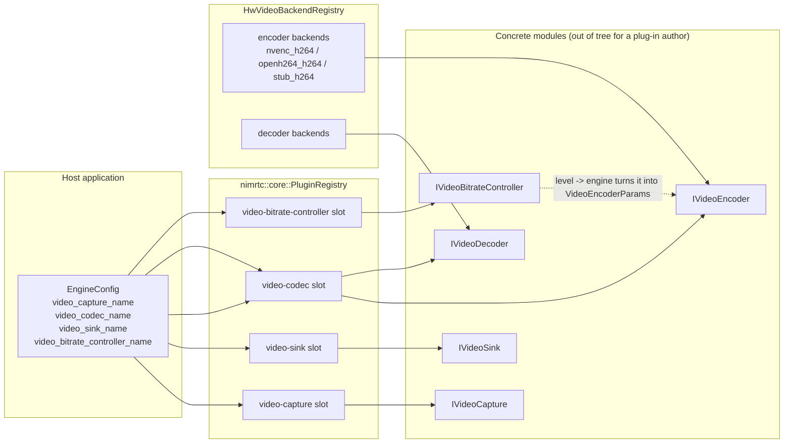
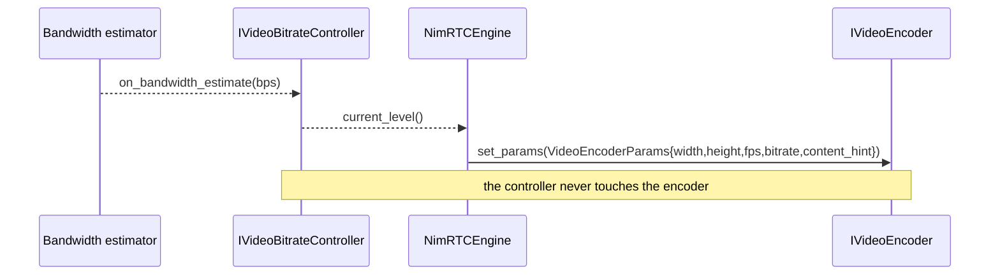

# Plugin Author Guide — Capture, Codec, Sink, Audio Device

> **Audience**: an engineer writing a NimRTC **plug-in** — a capture
> device, a hardware encoder, a renderer, an audio device, or a video rate
> controller — that runs inside `nimrtc::engine::NimRTCEngine` without
> forking the engine.
>
> **Status**: v1.3 / v1.4 (remote-desktop plan Track K, item **K5**).
> This guide is the hands-on companion to
> [`docs/plugin_author_guide.md`](../plugin_author_guide.md) (the general
> registration catalogue) and
> [`docs/hw_plugin_seam.md`](../hw_plugin_seam.md) (the hardware-backend
> seam). Where this guide and the general catalogue disagree, **this
> guide is the newer one** — it covers the remote-desktop seams the
> catalogue does not yet.
>
> **Pre-requisites**: C++20, a reading of
> [`docs/adr/ADR-015-api-stability-policy.md`](../adr/ADR-015-api-stability-policy.md)
> (what a public symbol promises) and of
> [`AGENTS.md`](../../AGENTS.md) (the layering rules).

---

## 0. What this guide is for

The acceptance criterion for this document is narrow and testable:

> **A reader can write a capture plug-in and a hardware-encoder plug-in
> from this guide alone.**

So the guide is built around two complete, compilable-ish worked
examples (§3 and §4), and the remaining sections are the contracts those
examples depend on. Everything in a code block is taken from the tree as
it stands — the symbol names, signatures and field names are the real
ones, and a snippet that would not compile is a documentation bug.

The house style follows
[`docs/guides/remote-desktop.md`](remote-desktop.md) (the signalling
guide): prose first, tables for contracts, ASCII or Mermaid for the
pictures, and a "what you must not do" section at the end because the
seams only work if the boundaries hold.

---

## 1. Where the seams live

Every seam is a header-only interface in
`src/plugins/include/nimrtc/plugins/`. Every seam has a **typed slot** in
`nimrtc::core::PluginRegistry` (`src/core/include/nimrtc/core/registry.hpp`),
a **registration macro**, and — for the seams the engine resolves — an
`EngineConfig` knob.

| Seam | Header | What it describes | Factory id (in-tree) | Registry slot / lookup |
|---|---|---|---|---|
| **Video capture** | `plugins/video_capture.hpp` | A capture *device*: enumeration, format negotiation, dirty rects, a bounded queue, the GPU handle. | `synthetic`, `windows-dxgi`, `windows-wgc`, `macos-screencapturekit`, `linux-pipewire`, `linux-x11` | `register_video_capture` / `get_video_capture`; macro `NIMRTC_REGISTER_VIDEO_CAPTURE`; knob `EngineConfig::video_capture_name` |
| **Video sink** | `plugins/video_sink.hpp` | A *renderer*: CPU frame delivery, GPU-surface delivery, presentation pacing, back-pressure. | `headless`, `pinned`, `d3d11`, `metal`, `egl` | `register_video_sink` / `get_video_sink`; macro `NIMRTC_REGISTER_VIDEO_SINK`; knob `EngineConfig::video_sink_name` |
| **Video encoder / decoder** | `plugins/video_codec.hpp` | The split codec seam: `IVideoEncoder` / `IVideoDecoder`, the passive parameter set, the zero-copy path. | the encoder/decoder *backends* are `stub_h264`, `openh264_h264`, `nvenc_h264`, `nvdec_h264`, … | the codec plugin itself goes in `register_video_codec` (macro `NIMRTC_REGISTER_VIDEO_CODEC`, knob `EngineConfig::video_codec_name`); the *backends* go in `HwVideoBackendRegistry` (macros `NIMRTC_REGISTER_VIDEO_ENCODER_BACKEND` / `NIMRTC_REGISTER_VIDEO_DECODER_BACKEND`) |
| **HW backend selection** | `plugins/hw_video_backend.hpp` | The `available()` probe, the priority order, the `zero_copy_supported` flag, the surface pool. | (not a factory id — a priority-ordered table) | `HwVideoBackendRegistry::instance()`; the class of backend is chosen by `EngineConfig::video_codec_backend` |
| **Video rate controller** | `plugins/video_bitrate_controller.hpp` | The resolution / frame-rate / bitrate ladder, the resolution floor, the keyframe-cost budget. | `video-bitrate-control` | `register_video_bitrate_controller` / `get_video_bitrate_controller`; macro `NIMRTC_REGISTER_VIDEO_BITRATE_CONTROLLER`; knob `EngineConfig::video_bitrate_controller_name` |
| **Audio source** | `plugins/audio_source.hpp` | A capture device (a microphone): the callback path and the pull path. | `synthetic`, `portaudio` | **no registry slot** — resolved through `nimrtc::audio_device::source_factory(id)` |
| **Audio sink** | `plugins/audio_sink.hpp` | A playback device (a loudspeaker): the write path, the played-sample counter. | `synthetic`, `portaudio` | **no registry slot** — resolved through `nimrtc::audio_device::sink_factory(id)` |
| **Audio device vocabulary** | `plugins/audio_device.hpp` | `AudioDeviceFormat`, `AudioDevice`, `AudioDeviceCapabilities`, `AudioDeviceStats`. | — | shared by both audio seams |
| **HW capability bases** | `plugins/hw_seam.hpp` | `HwBackend` (the *accelerator class*), `IHwVideoEncoder` / `IHwVideoDecoder` / `IHwVideoCapture` (the optional capability mix-ins). | — | — |

Two facts in that table deserve to be read twice:

1. **The audio device seams are not registry slots.** They resolve
   through the module's own lookup functions, because a device backend
   is a *module* concern (PortAudio, the synthetic device) and the
   registry's typed slots are reserved for the families the engine
   resolves by name. A host therefore writes
   `nimrtc::audio_device::source_factory("portaudio")`, not
   `EngineConfig::audio_source_name = "portaudio"`.
2. **The codec has two registries.** The *codec plugin* (a "h264" family
   plug-in) is a registry entry; the *backend* (a concrete NVENC or
   OpenH264 implementation) is an entry in `HwVideoBackendRegistry`.
   A plug-in author normally writes **both**: the plugin wrapper, and
   the backend that the wrapper selects.

### 1.1 The whole picture



Note the dashed arrow: **the rate controller never touches the encoder.**
The engine reads the controller's level and turns it into a
`VideoEncoderParams`, and pushes that. That is the whole design of the
rate-control seam, and §4.3 explains why it matters.

---

## 2. The five-step recipe for any plug-in

Every plug-in in NimRTC — capture, sink, codec, rate controller — follows
the same five steps.

### Step 1 — Implement the interface

Include the seam header and derive from the interface. The interfaces
are pure-virtual contracts; nothing else is required.

```cpp
// my_capture.hpp
#pragma once
#include <nimrtc/plugins/video_capture.hpp>

class MyCapture final : public nimrtc::plugins::IVideoCapture {
public:
    // ---- IPlugin ----
    const char* name() const noexcept override { return "my-capture"; }

    // ---- IVideoCapture ----
    [[nodiscard]] std::vector<nimrtc::plugins::CaptureDevice>
    enumerate_devices() const noexcept override;
    [[nodiscard]] std::vector<nimrtc::plugins::CaptureFormat>
    supported_formats(const std::string& device_id) const noexcept override;
    [[nodiscard]] nimrtc::plugins::CaptureCapabilities
    capabilities() const noexcept override;
    nimrtc::plugins::Status open() noexcept override;
    void close() noexcept override;
    [[nodiscard]] bool is_open() const noexcept override;
    [[nodiscard]] nimrtc::plugins::CaptureConfig
    config() const noexcept override;
    nimrtc::plugins::Status
    pop_frame(nimrtc::plugins::CaptureFrame& out) noexcept override;
    void set_frame_callback(nimrtc::plugins::CaptureFrameCallback cb) noexcept override;
    [[nodiscard]] nimrtc::plugins::CaptureStats stats() const noexcept override;
};
```

> **Note on `open()` / `close()`.** `IVideoCapture` inherits `IPlugin`,
> which already declares `open()` and `close()`; the capture-specific
> declarations *override* the inherited ones. So you write each of them
> **once** — as above — and the `override` keyword on both is what the
> compiler checks for you.

### Step 2 — Implement the factory

The factory is the thing the registry holds. It is `const`, it has an
`id()` and a `display_name()`, and it returns a **raw owning pointer** —
the caller owns the instance and deletes it.

```cpp
// my_capture_factory.hpp
#pragma once
#include <nimrtc/plugins/video_capture.hpp>

class MyCaptureFactory final : public nimrtc::plugins::IVideoCaptureFactory {
public:
    std::string_view id() const noexcept override { return "my-capture"; }
    std::string_view display_name() const noexcept override {
        return "My capture device";
    }
    nimrtc::plugins::IVideoCapture*
    create(nimrtc::plugins::CaptureConfig cfg) const override {
        return new MyCapture(std::move(cfg));
    }
};
```

The id must match `^[a-z][a-z0-9_-]*$` (ADR-023). `"my-capture"` is
legal; `"MyCapture"` and `"my capture"` are not. A third-party plug-in
must not use the `nimrtc_` prefix, and should namespace its id
(`acme_capture`).

### Step 3 — Register it

**The exact macro** (copied from `src/core/include/nimrtc/core/registry.hpp`):

```cpp
#define NIMRTC_REGISTER_VIDEO_CAPTURE(id, factory_ptr)                   \
    NIMRTC_DETAIL_REGISTER_ID_GUARD(#id)                   \
    static ::nimrtc::core::detail::Registrar                          \
        NIMRTC_UNIQUE_NAME(_reg_video_capture_){                         \
            ::nimrtc::core::PluginRegistry::instance(),                \
            ::nimrtc::core::detail::Registrar::Category::kVideoCapture,   \
            #id, factory_ptr }
```

So the call site is:

```cpp
// my_capture_init.cpp
#include <nimrtc/core/registry.hpp>
#include "my_capture_factory.hpp"

static const MyCaptureFactory g_factory{};

NIMRTC_REGISTER_VIDEO_CAPTURE(my_capture, &g_factory);
```

Three things about that line are load-bearing:

- **The id is a bare token**, not a quoted literal. The macro stringifies
  it, so `my_capture` becomes the id `"my_capture"`. Passing
  `"my_capture"` (with quotes) registers an id that *contains the quote
  characters* — the registration succeeds and the lookup never matches.
- **The id is validated at compile time.** `NIMRTC_DETAIL_REGISTER_ID_GUARD`
  rejects a token that violates the grammar, so a malformed id is a
  build error, not a runtime surprise.
- **The factory must outlive the registry**, so it is a `static`.

The in-tree modules call the registry directly instead of using the
macro, because their ids are hyphenated (`"windows-dxgi"`) and a
hyphenated id cannot be spelled as a bare token:

```cpp
core::PluginRegistry::instance().register_video_capture(
    factory.id(), &factory);
```

The macro list for the other seams follows the same shape:

| Seam | Macro |
|---|---|
| Video capture | `NIMRTC_REGISTER_VIDEO_CAPTURE(id, factory_ptr)` |
| Video sink | `NIMRTC_REGISTER_VIDEO_SINK(id, factory_ptr)` |
| Video codec | `NIMRTC_REGISTER_VIDEO_CODEC(id, factory_ptr)` |
| Video rate controller | `NIMRTC_REGISTER_VIDEO_BITRATE_CONTROLLER(id, factory_ptr)` |
| Encoder backend | `NIMRTC_REGISTER_VIDEO_ENCODER_BACKEND(be_literal)` |
| Decoder backend | `NIMRTC_REGISTER_VIDEO_DECODER_BACKEND(be_literal)` |

### Step 4 — Make the engine resolve it

The engine resolves by **name**, at `open()` time:

```cpp
nimrtc::engine::EngineConfig cfg;
cfg.video_capture_name = "my_capture";   // the id you registered under
cfg.video_sink_name    = "headless";
cfg.video_codec_name   = "h264";
cfg.video_bitrate_controller_name = "video-bitrate-control";

nimrtc::engine::NimRTCEngine engine(cfg);
engine.open();
```

If the id does not resolve, the engine **reports** it rather than
silently substituting an in-tree implementation: the session opens
without the component and `on_error()` fires with the family's error
code. The capture and sink seams are "reported, non-fatal" families —
the general catalogue's §4.1 vocabulary. A missing capture device is
therefore a *loud* failure, not a black screen.

If you want the plugin to be picked up without the host naming it, call
the in-tree registrars once at startup:

```cpp
#include <nimrtc/core/registry.hpp>
nimrtc::core::register_all_default_plugins();
```

### Step 5 — Test it

§8 covers this in full. The short version: a plug-in test must run on
**every** CI leg, with **no network** and **no real codec**, and it must
include a **negative control**.

### 2.1 The CMake target you must link

Your plug-in is a module. Per Layout Invariant 3 (AGENTS.md) it is
self-contained — its own `CMakeLists.txt`, `include/`, `src/`, `tests/`
— and it links **only** the seams it implements:

```cmake
# src/modules/my_capture/CMakeLists.txt
add_library(nimrtc_my_capture STATIC
    src/my_capture.cpp
    src/my_capture_factory.cpp
)
add_library(nimrtc::my_capture ALIAS nimrtc_my_capture)

nimrtc_apply_options(nimrtc_my_capture)

target_link_libraries(nimrtc_my_capture
    PUBLIC
        nimrtc::core       # Status, IPlugin, the registry
        nimrtc::plugins    # IVideoCapture and the other seams
)

target_include_directories(nimrtc_my_capture
    PUBLIC  $<BUILD_INTERFACE:${CMAKE_CURRENT_SOURCE_DIR}/include>
    PRIVATE ${CMAKE_CURRENT_SOURCE_DIR}/src)
```

The two targets you link are:

| Target | What it gives you |
|---|---|
| `nimrtc::core` | `nimrtc::core::Status`, `PluginRegistry`, `NIMRTC_PLUGIN_ID`, the API-version macros. Header-only. |
| `nimrtc::plugins` | The seam headers. Also `nimrtc::video_frame` transitively (the `GpuBuffer` / `GpuBackend` types are re-exported from `plugins::`). |

Do **not** link `nimrtc::engine` from a plug-in. A plug-in does not
know about the engine; the engine knows about the plug-in.

---

## 3. Writing a capture plug-in

A capture device is the *source* of a remote-desktop session. It
enumerates devices, negotiates a format, delivers frames on its own
thread, and reports what changed.

### 3.1 The contract in one table

| Question | The seam's answer |
|---|---|
| What devices exist? | `enumerate_devices()` → `std::vector<CaptureDevice>`. An **empty list is a legitimate answer**, not an error (a CI machine with no screen). |
| What can this device deliver? | `supported_formats(device_id)` → `std::vector<CaptureFormat>`. |
| What can this backend do at all? | `capabilities()` → `CaptureCapabilities` (device-wide statements). |
| Which format is in force? | `config()` **after** `open()` — the request is not a guarantee. |
| Where do frames come from? | `pop_frame(out)` (pull) and `set_frame_callback(cb)` (push). |
| How do I count what happened? | `stats()` → `CaptureStats`. |
| What went wrong? | `Status` from `open()` / `pop_frame()`, plus **your own** error enum for the failure modes the generic `Status` cannot distinguish (see §3.6). |

### 3.2 The skeleton

```cpp
// my_capture.hpp
#pragma once
#include <cstdint>
#include <string>
#include <vector>

#include <nimrtc/plugins/video_capture.hpp>
#include <nimrtc/video_capture/capture_queue.hpp>

class MyCapture final : public nimrtc::plugins::IVideoCapture {
public:
    explicit MyCapture(nimrtc::plugins::CaptureConfig cfg) noexcept
        : cfg_(std::move(cfg)), queue_(cfg_.queue_depth == 0
                                              ? 2u
                                              : cfg_.queue_depth) {
        queue_.set_drop_policy(cfg_.drop_policy);
    }

    ~MyCapture() override { close(); }

    // ---- IPlugin ---------------------------------------------------------
    const char* name() const noexcept override { return "my-capture"; }

    nimrtc::plugins::Status open() noexcept override {
        if (open_) return nimrtc::plugins::kOk;   // idempotent

        // 1. Negotiate the format against the device.
        const auto formats = supported_formats(cfg_.device_id);
        if (formats.empty()) {
            last_error_ = MyCaptureError::kDeviceNotFound;
            return nimrtc::plugins::kErrInvalidParam;
        }

        // 2. Pick the format.  The *strictest* rule wins: a
        //    zero-copy format also needs the device-wide flag, and a
        //    dirty-rect format needs the device-wide dirty-rect flag.
        const auto chosen = negotiate(cfg_.format, formats, capabilities());
        if (!chosen) {
            last_error_ = MyCaptureError::kUnsupportedFormat;
            return nimrtc::plugins::kErrInvalidParam;
        }
        cfg_.format = *chosen;

        // 3. Acquire the real device.
        if (!open_device()) {
            last_error_ = MyCaptureError::kCaptureFailed;
            return nimrtc::plugins::kErrHardwareError;
        }

        open_ = true;
        return nimrtc::plugins::kOk;
    }

    void close() noexcept override {
        if (!open_) return;
        stop_thread();
        queue_.clear();
        open_ = false;
    }

    // ---- IVideoCapture ----------------------------------------------------
    [[nodiscard]] std::vector<nimrtc::plugins::CaptureDevice>
    enumerate_devices() const noexcept override {
        return devices_;
    }

    [[nodiscard]] std::vector<nimrtc::plugins::CaptureFormat>
    supported_formats(const std::string& device_id) const noexcept override {
        (void)device_id;
        return formats_;
    }

    [[nodiscard]] nimrtc::plugins::CaptureCapabilities
    capabilities() const noexcept override {
        nimrtc::plugins::CaptureCapabilities caps;
        caps.zero_copy         = false;   // this device stages on the CPU
        caps.dirty_rects       = false;   // and does not diff frames
        caps.cursor_composited = false;
        caps.region_selection  = false;
        caps.enumeration       = true;    // the list is real
        caps.max_pixels        = 1920ull * 1080ull;
        caps.max_fps           = 30;
        caps.backend           = "my-capture";
        return caps;
    }

    [[nodiscard]] bool is_open() const noexcept override { return open_; }

    [[nodiscard]] nimrtc::plugins::CaptureConfig
    config() const noexcept override {
        return cfg_;   // the *negotiated* config
    }

    nimrtc::plugins::Status pop_frame(
        nimrtc::plugins::CaptureFrame& out) noexcept override {
        if (!open_) return nimrtc::plugins::kErrClosed;
        if (!queue_.pop(out)) return nimrtc::plugins::kErrNotReady;
        ++stats_.frames_captured;
        return nimrtc::plugins::kOk;
    }

    void set_frame_callback(
        nimrtc::plugins::CaptureFrameCallback cb) noexcept override {
        cb_ = std::move(cb);
    }

    [[nodiscard]] nimrtc::plugins::CaptureStats
    stats() const noexcept override {
        return stats_;
    }

private:
    // The capture thread pushes into the bounded queue.
    void capture_thread() noexcept {
        while (running_) {
            // ... grab a frame from the device ...
            nimrtc::plugins::CaptureFrame frame;
            frame.pixels = pixels;
            frame.size   = size;
            frame.stride = stride;
            frame.width  = w;
            frame.height = h;
            frame.capture_ts_us = ts;
            frame.frame_seq     = seq;
            frame.dirty         = dirty;

            // push() applies the drop policy and counts the drop.
            const auto res = queue_.push(frame.pixels, frame.size, frame.stride,
                                         frame.width, frame.height,
                                         frame.capture_ts_us, frame.frame_seq,
                                         frame.dirty);
            if (res == nimrtc::video_capture::CaptureQueue::PushResult::
                            kDroppedOldest) {
                ++stats_.frames_dropped;
            }

            // The callback fires on *this* thread and must not block.
            nimrtc::plugins::CaptureFrame peeked;
            if (cb_ && queue_.peek(peeked)) cb_(peeked);
        }
    }

    nimrtc::plugins::CaptureConfig cfg_;
    nimrtc::video_capture::CaptureQueue queue_;
    nimrtc::plugins::CaptureFrameCallback cb_;
    nimrtc::plugins::CaptureStats stats_{};
    std::vector<nimrtc::plugins::CaptureDevice> devices_;
    std::vector<nimrtc::plugins::CaptureFormat> formats_;
    MyCaptureError last_error_ = MyCaptureError::kNone;
    bool open_ = false;
    bool running_ = false;
};
```

The helpers the skeleton elides are the ones that touch *your* platform:

| Helper | What it does |
|---|---|
| `negotiate(request, offered, caps)` | Picks the format to open with, honouring the two-level rule of §3.4. Returns `std::optional<CaptureFormat>`. |
| `open_device()` | Acquires the platform device (DXGI duplication, a `SCStream`, an X11 drawable, …). Returns `false` on failure and leaves `last_error_` set. |
| `stop_thread()` | Joins the capture thread. Must be idempotent. |
| `MyCaptureError` | **Your** error enum — see §3.6. It lives in your module's public header, not in `src/plugins/`. |

The three elided device variables (`pixels`, `size`, `stride`, `w`, `h`,
`ts`, `seq`, `dirty`) are what your platform's capture callback hands
you; the skeleton names them so the queue call reads like the real one.
The one thing that matters is that `push()` is called **from your capture
thread** and `pop_frame()` **from the engine's tick thread** — the queue
is what makes that safe.

### 3.3 The bounded-queue discipline

The queue is **not** optional, and it is **not** yours to reimplement:
`nimrtc::video_capture::CaptureQueue`
(`src/modules/video_capture/include/nimrtc/video_capture/capture_queue.hpp`)
is the portable mechanism, and every platform backend in the tree is a
thin adapter over it.

Its contract, in full:

| Rule | Why |
|---|---|
| The queue is **bounded**. Depth comes from `CaptureConfig::queue_depth`; depth 1 means "no queueing — the consumer always sees the newest frame". | An unbounded queue turns a slow encoder into unbounded *latency* instead of a dropped frame. |
| The overflow behaviour is the **drop policy**, not a branch in your code. | Which frame to drop depends on the *content*. |
| `push()` **copies** the pixel bytes. | The device's own buffer is recycled the moment your callback returns — you must copy or map before returning. |
| `pop()` **never blocks**. It returns false when the queue is empty. | The engine's tick loop must not be parked by a quiet device. |
| The popped pixels stay valid **until the next `pop()`**. | The queue keeps the popped frame alive internally, so the consumer can read it without copying again. |
| `peek()` returns the same bytes `pop()` will return. | The push callback must see exactly what the consumer will later pop. |

The drop policy is content-driven, and this is not a stylistic choice —
[ADR-022](../adr/ADR-022-screen-content-as-content-type.md) Decision 6
records it:

```cpp
// src/plugins/include/nimrtc/plugins/video_capture.hpp
enum class CaptureDropPolicy : std::uint8_t {
    kDropOldest   = 0,  ///< screen content: the newest frame is the truth
    kDropNewest   = 1,  ///< camera: a slightly stale frame beats a late one
    kDropIncoming = 2,  ///< strict "never replace a queued frame"
};
```

`CaptureDropPolicy::kDropOldest` is the default, and it is the right
default for a screen.

### 3.4 Format negotiation

Negotiation is a **two-level** statement, and the stricter of the two
always wins:

```
device-wide:  CaptureCapabilities::zero_copy        (can this backend avoid a readback?)
per-format:   CaptureFormat::zero_copy              (can THIS format avoid a readback?)

device-wide:  CaptureCapabilities::dirty_rects      (does this backend report dirty rects?)
per-format:   CaptureFormat::has_dirty_rects        (does THIS format carry them?)
```

So a format that claims `zero_copy = true` on a device whose
`capabilities().zero_copy` is false is an **unsupported combination**,
and the device must refuse it at `open()` time — not discover it at the
first frame.

The other negotiation rules:

- `CaptureConfig::format` with a **zero width or height** means "the
  device's best".
- `CaptureFormat::tag` is an **opaque platform format tag**. The engine
  never interprets it; it compares the format for equality against the
  device's own list and hands it back in `open()`.
- A non-zero `CaptureConfig::region` requires
  `capabilities().region_selection`.
- `CaptureConfig::want_cursor` is a **preference**, not a requirement.
  It is honoured only when `capabilities().cursor_composited` is true.
- After `open()` succeeds, `config()` reports the format **actually in
  force**. A device that had to fall back to another rate says so.

### 3.5 The dirty-rect contract

```cpp
struct CaptureDirtyRects {
    bool full_frame = true;              ///< "everything changed"
    std::vector<CaptureRegion> rects;    ///< in *source* pixels
};
```

- `full_frame == true` means "ignore the rects, everything changed".
  This is the **conservative** answer and the default: a device with no
  per-pixel diff information reports `full_frame = true`.
- `full_frame == false` with an **empty** `rects` means "nothing
  changed at all" — the screen is static. This is the state a
  remote-desktop encoder cares about most, and it is the state the
  in-tree synthetic device produces when frozen.
- The rectangles are in **source** pixels — the pixel of the *captured*
  surface, before any scaling the pipeline applies. The same convention
  `plugins::VideoRegion` uses, so a capture rectangle can be handed to
  the encoder unchanged.

### 3.6 The error-code discipline

> **Every failure mode gets its own code.**

The generic `plugins::Status` has nine values, and it is deliberately
coarse. "The user refused the capture consent prompt" and "the GPU fell
off the bus" call for completely different responses from the host, and
a host that receives the same code for both cannot react correctly.

The in-tree pattern is a **backend-specific error enum** plus an error
callback:

```cpp
// src/modules/video_capture/include/nimrtc/video_capture/windows_capture.hpp
enum class NIMRTC_API_STABLE WindowsCaptureError : std::uint32_t {
    kNone = 0,
    kConsentDenied    = 0x5701,  ///< the user refused the consent prompt
    kDeviceLost       = 0x5702,  ///< display changed, GPU reset
    kDeviceNotFound   = 0x5703,
    kD3dDeviceFailed  = 0x5704,
    kUnsupportedFormat= 0x5705,
    kCaptureFailed    = 0x5706,
};

using WindowsCaptureErrorCallback =
    std::function<void(WindowsCaptureError error, std::string_view message)>;
```

The Unix side has its own enum with the same discipline:

```cpp
// src/modules/video_capture/include/nimrtc/video_capture/unix_capture_core.hpp
enum class NIMRTC_API_STABLE UnixCaptureError : std::uint32_t {
    kNone,
    kPermissionDenied,
    kDeviceNotFound,
    kUnsupportedFormat,
    kCaptureFailed,
    kDeviceLost,
    kDisplayUnavailable,
    kPortalUnavailable,
};
```

The rules that follow from this:

1. Your enum lives in **your** module's public header, not in
   `src/plugins/`. The seam stays generic; your failure modes are yours.
2. Your enum has a **name function** (`windows_capture_error_name`,
   `unix_capture_error_name`) so a log line is readable.
3. The values are **stable within v1.x**.
4. A device that notices a failure **stops cleanly** and reports it. It
   never spins and never aborts the process.
5. `open()` returns the generic `Status`; the *specific* code travels on
   the callback (`set_error_callback`) and through `last_error()`.

### 3.7 The zero-copy `GpuBuffer` contract

If your device can deliver a native GPU surface, it sets
`CaptureCapabilities::zero_copy` and the per-format `zero_copy` flag,
and it fills the `CaptureFrame`'s GPU fields:

```cpp
struct CaptureFrame {
    ...
    bool          has_gpu_handle = false;
    VideoPixelFormat format = VideoPixelFormat::kUnknown;
    GpuBackend    gpu_backend = GpuBackend::kNone;
    void*         gpu_handle = nullptr;       ///< borrowed
    std::uint32_t gpu_pitch_bytes = 0;
    ...
};
```

The rules:

- The `gpu_handle` is **borrowed**. It stays valid until the next
  `pop_frame()` — exactly like the `pixels` pointer.
- `gpu_backend` says which concrete type the handle is
  (`ID3D11Texture2D` for `kWindowsD3D11Texture`, a `CUarray` for
  `kNvidiaCudaArray`, and so on).
- The device must **count** what it did: `CaptureStats::frames_zero_copy`
  for the frames that never crossed the PCI bus, and
  `CaptureStats::bytes_copied` for the bytes that did. A device that
  falls back to CPU staging says so — it never pretends to be
  zero-copy.

### 3.8 Registering and testing it

```cpp
// my_capture_init.cpp
#include <nimrtc/core/registry.hpp>
#include "my_capture_factory.hpp"

static const MyCaptureFactory g_factory{};
NIMRTC_REGISTER_VIDEO_CAPTURE(my_capture, &g_factory);
```

```cpp
// selecting it
nimrtc::engine::EngineConfig cfg;
cfg.video_capture_name = "my_capture";
cfg.video_capture_pump  = true;   // let the engine drive the device
```

`EngineConfig::video_capture_pump` (default `true`) is what makes the
engine pop a frame on its tick thread and push it through the encode →
packetize → enqueue path — so a capture plug-in plus an encoder produce
an outbound RTP stream **without the host ever calling `send_video()`**.

---

## 4. Writing a hardware-encoder plug-in

A hardware encoder is two things at once: a **codec** (the family
plug-in the engine resolves by name) and a **backend** (the concrete
NVENC / VA-API / VideoToolbox implementation the backend selector picks).

### 4.1 The split seam: `IVideoEncoder` / `IVideoDecoder`

```cpp
class NIMRTC_API_STABLE IVideoEncoder : public virtual IPlugin {
public:
    virtual VideoCodecKind kind() const noexcept = 0;
    virtual std::string_view codec_name() const noexcept = 0;

    virtual Status encode(const VideoFrame& raw,
                          std::uint8_t* output,
                          std::size_t   output_capacity,
                          EncodedVideoFrame& encoded_out) noexcept = 0;

    virtual Status force_keyframe() noexcept = 0;
    virtual VideoCodecCapabilities capabilities() const noexcept { return {}; }
    virtual bool supports_zero_copy_encode() const noexcept { return false; }
    virtual Status encode_zero_copy(const GpuBuffer& gpu,
                                    EncodedVideoFrame& encoded_out) noexcept {
        return kErrUnsupported;
    }
    virtual std::shared_ptr<GpuBufferPool> input_pool() const noexcept {
        return nullptr;
    }

    virtual Status set_params(const VideoEncoderParams& params) noexcept = 0;
    virtual VideoEncoderParams params() const noexcept = 0;
    virtual VideoCodecStats stats() const noexcept = 0;
    virtual std::string_view backend_id() const noexcept { return "unknown"; }
    virtual bool is_hardware_accelerated() const noexcept { return false; }
};
```

The `encode()` signature is worth reading twice: the *output* is a
caller-owned byte buffer plus its capacity, and the *result* is an
`EncodedVideoFrame` (the codec-agnostic descriptor of the coded
picture) — the bytes the caller asked for and the metadata the peer
needs travel on two different objects.

The encoder also carries the **incremental-encode** half of the seam
(`supports_incremental_encode()`, `set_incremental_request()`,
`incremental_request()`, `last_encoded_region()`); §6.3 explains it.

The decoder mirror (`IVideoDecoder`) has `decode()`,
`decode_zero_copy()`, `output_pool()` and the same telemetry methods.
The point of the split (plan **B1**) is that a hardware encoder and a
hardware decoder are *different libraries on different devices*: NVENC
and NVDEC are not one object, and a camera gateway encodes but never
decodes. The combined `IVideoCodec` needed a composite wrapper to paper
over that; the split does not.

`IVideoCodec` still exists, marked
`[[deprecated]]` with the replacement named in the message. A new
plug-in must implement `IVideoEncoder` / `IVideoDecoder`.

### 4.2 The `available()`-probe-then-create shape

The backend selector is `HwVideoBackendRegistry`
(`src/plugins/include/nimrtc/plugins/hw_video_backend.hpp`). A backend
is a descriptor with six facts about it:

```cpp
struct NIMRTC_API_STABLE VideoEncoderBackend {
    std::string_view id;            ///< "nvenc_h264"
    std::string_view description;
    HwBackend        backend;        ///< the accelerator class
    int              priority = 0;   ///< higher wins
    VideoCodecKind   codec_kind = VideoCodecKind::kH264;
    bool             is_hw = false;
    std::function<bool(const VideoCodecConfig&)>  available;
    std::function<std::unique_ptr<IVideoCodec>(VideoCodecConfig)> create;
    bool             zero_copy_supported = false;
    std::function<std::shared_ptr<GpuBufferPool>(VideoCodecConfig)> pool_factory;
};
```

The shape of a hardware backend is therefore:

```cpp
plugins::VideoEncoderBackend make_my_hw_encoder_backend() {
    plugins::VideoEncoderBackend be;
    be.id             = "myhw_h264";
    be.description    = "My hardware H.264 encoder";
    be.backend        = plugins::HwBackend::Custom;   // or a real class
    be.priority       = 400;        // hardware backends: > 100
    be.codec_kind     = plugins::VideoCodecKind::kH264;
    be.is_hw          = true;
    be.zero_copy_supported = true;

    // The probe.  It must NOT instantiate heavy resources: it is called
    // once per engine start-up, and device enumeration is expensive.
    be.available = [](const plugins::VideoCodecConfig& cfg) noexcept -> bool {
        return myhw::probe_driver_loaded() && myhw::supports_size(cfg);
    };

    be.create = [](plugins::VideoCodecConfig cfg)
            -> std::unique_ptr<plugins::IVideoCodec> {
        return std::make_unique<MyHwEncoder>(std::move(cfg));
    };

    return be;
}
```

and the registration:

```cpp
NIMRTC_REGISTER_VIDEO_ENCODER_BACKEND(
    plugins::VideoEncoderBackend{
        .id = "myhw_h264",
        .description = "My hardware H.264 encoder",
        .backend = plugins::HwBackend::Custom,
        .priority = 400,
        .codec_kind = plugins::VideoCodecKind::kH264,
        .is_hw = true,
        .available = [](const plugins::VideoCodecConfig& c) noexcept -> bool {
            return myhw::probe(c);
        },
        .create = [](plugins::VideoCodecConfig c)
                -> std::unique_ptr<plugins::IVideoCodec> {
            return std::make_unique<MyHwEncoder>(std::move(c));
        },
    });
```

> **Note.** `NIMRTC_REGISTER_VIDEO_ENCODER_BACKEND` takes the *whole
> backend literal* (not an id and a pointer) and lives in
> `plugins/hw_video_backend.hpp`, not in `core/registry.hpp`. It is a
> different registry — `HwVideoBackendRegistry` — and it is **not**
> covered by the `NIMRTC_REGISTER_*` id-grammar guard, because a
> backend id is not a plugin id.

The **priority ordering** the selector applies:

| Priority band | Who lives there |
|---|---|
| `> 100` | Hardware backends (NVENC 450, AMF, QSV, VA-API, VideoToolbox …). |
| `50` | The real software codec (OpenH264 is priority 50 — above the stub, below every accelerator). |
| `0` | The built-in stub (`stub_h264`) — always available, so `select_encoder()` is never null. |

Selection policy:

1. If `preferred_id` is set and matches an available backend → use it.
2. Otherwise walk the priority-sorted list and take the first backend
   whose `available()` returns true.
3. If nothing is available → the stub.

And the **`codec_backend` class selector** (plan **B2**):

```cpp
enum class NIMRTC_API_STABLE VideoCodecBackendPreference : std::uint8_t {
    kAuto     = 0,  ///< hardware first, software as the fallback
    kHardware = 1,  ///< hardware only — fail rather than fall back
    kSoftware = 2,  ///< software only — fail rather than fall back
};
```

The host sets it with `EngineConfig::video_codec_backend` (`"auto"`,
`"hardware"`, `"software"`). In `kHardware` / `kSoftware` mode the
ineligible backends are **not** eligible: the selection returns `nullptr`
rather than handing back one of them. A host that asked for hardware
must not silently get software.

The engine reports both answers so a mismatch is visible without
parsing a log:

```cpp
struct Stats {
    std::string video_codec_backend;             ///< "nvenc", "openh264", …
    bool        video_codec_hardware_accelerated;
    std::string video_codec_backend_preference;   ///< what the host asked for
};
```

### 4.3 The `VideoEncoderParams` authority — the encoder is *passive*

This is the single most important rule in the whole guide.

> **The encoder never queries the bandwidth estimator, the rate
> controller or any other network signal. The engine computes the
> parameter set and pushes it.**

The parameter set is one value:

```cpp
struct NIMRTC_API_STABLE VideoEncoderParams {
    std::uint32_t width = 0;
    std::uint32_t height = 0;
    std::uint32_t fps = 30;
    std::uint32_t bitrate_bps = 0;
    std::uint32_t keyframe_interval = 60;
    std::uint8_t  qp = 255;                       ///< 255 = "unset"
    VideoPixelFormat pixel_format = VideoPixelFormat::kI420;

    enum class ContentHint : std::uint8_t {
        kUnspecified = 0,  ///< no opinion (camera content)
        kMotion     = 1,  ///< camera-like: spend the budget on motion
        kDetail     = 2,  ///< screen content: preserve fine detail / text
        kText       = 3,  ///< screen content dominated by text
    };
    ContentHint content_hint = ContentHint::kUnspecified;

    VideoColorDescription color;

    [[nodiscard]] bool has_qp() const noexcept { return qp != 255; }
    [[nodiscard]] bool has_geometry() const noexcept {
        return width != 0 && height != 0;
    }
};
```

The contract of `set_params()`:

- The engine calls it when the geometry, the frame rate, the bitrate or
  the content hint changes.
- Your encoder **stores** the set and applies it to the underlying
  hardware session.
- Your encoder must **not** call back into the engine, the BWE or the
  rate controller. There is no such call in the interface — and that is
  the point.
- `params()` returns the set currently in force, so a host can read back
  what the encoder was actually told.

Why the separation matters: the video path has two halves that must
never meet. The encoder is **passive** — it codes the frame it is handed
at the bitrate it is handed, and it knows nothing about the network. The
rate controller is **active** — it watches the bandwidth estimate, the
measured outbound bitrate and the keyframe feedback, and decides what the
encoder should be producing. The contract between them is one value, and
the engine is the only party that translates one into the other:



### 4.4 The parameter-set-on-resolution-change rule

> **When the geometry changes, the new parameter sets must ride with the
> new frame.**

A resolution change is a *parameter-set change* (plan **B13**). The
encoder must:

1. **Restart** its underlying session (or reconfigure it) for the new
   geometry.
2. Emit the new **SPS / PPS** (or VPS for HEVC, or the AV1 sequence
   header) **together with the first frame at the new resolution**.
3. Emit that frame as a **key frame**.

The failure mode this prevents is the one that costs a remote-desktop
session its picture: the peer receives a frame at a new resolution with
no parameter sets, cannot decode it, and asks for a key frame — over and
over, at exactly the moment the link is congested.

The engine sees the symptom from the other side too: a peer that
repeatedly asks for keyframes is a peer that cannot decode what it is
getting, and the rate controller lowers the level (plan B7).

So, concretely, in your encoder:

```cpp
nimrtc::plugins::Status MyHwEncoder::set_params(
        const nimrtc::plugins::VideoEncoderParams& p) noexcept {
    const bool geometry_changed =
        p.width  != params_.width  ||
        p.height != params_.height;

    if (geometry_changed) {
        // Restart the hardware session for the new geometry and
        // remember that the next frame must carry the parameter sets.
        if (!restart_session(p.width, p.height)) {
            return nimrtc::plugins::kErrHardwareError;
        }
        pending_parameter_sets_ = true;
        force_keyframe_next_ = true;
    }

    apply_bitrate(p.bitrate_bps);
    apply_qp(p);
    apply_content_hint(p.content_hint);

    params_ = p;
    return nimrtc::plugins::kOk;
}
```

and in your encode path, `pending_parameter_sets_` is what makes the
first frame at the new geometry carry the SPS / PPS.

### 4.5 The capability query

`VideoCodecCapabilities` is what makes an unsupported geometry fail at
`open()` instead of at the first frame:

```cpp
struct NIMRTC_API_STABLE VideoCodecCapabilities {
    std::vector<VideoPixelFormat> pixel_formats{};
    std::vector<std::string>      profiles{};
    std::uint32_t max_width = 0, max_height = 0;
    std::uint32_t min_width = 0, min_height = 0;
    std::uint32_t max_fps = 0;
    std::uint32_t max_bitrate_bps = 0;
    bool zero_copy_encode = false;
    bool zero_copy_decode = false;

    [[nodiscard]] bool accepts_size(std::uint32_t w, std::uint32_t h) const noexcept;
    [[nodiscard]] bool accepts_fps(std::uint32_t fps) const noexcept;
    [[nodiscard]] bool accepts_bitrate(std::uint32_t bps) const noexcept;
    [[nodiscard]] bool accepts_pixel_format(VideoPixelFormat fmt) const noexcept;
};
```

A dimension of `0` in the *capability* means "no limit in that
direction"; a dimension of `0` in the *request* means "unconstrained".

### 4.6 Registering the codec plugin itself

The codec **plugin** is what `EngineConfig::video_codec_name` names. It
is an ordinary registry entry:

```cpp
// my_codec_init.cpp
#include <nimrtc/core/registry.hpp>
#include "my_codec_factory.hpp"

static const MyCodecFactory g_factory{};
NIMRTC_REGISTER_VIDEO_CODEC(my_h264, &g_factory);
```

The factory implements `IVideoCodecFactory` (the deprecated combined
interface) or — for a split-seam plug-in — the two split factories
`IVideoEncoderFactory` / `IVideoDecoderFactory`:

```cpp
class NIMRTC_API_STABLE IVideoEncoderFactory {
public:
    virtual ~IVideoEncoderFactory() = default;
    virtual std::string_view id() const noexcept = 0;
    virtual std::string_view display_name() const noexcept = 0;
    virtual IVideoEncoder* create_encoder(VideoCodecConfig cfg) const = 0;
};

class NIMRTC_API_STABLE IVideoDecoderFactory {
public:
    virtual ~IVideoDecoderFactory() = default;
    virtual std::string_view id() const noexcept = 0;
    virtual std::string_view display_name() const noexcept = 0;
    virtual IVideoDecoder* create_decoder(VideoCodecConfig cfg) const = 0;
};
```

> **A note on the in-tree state.** The split interfaces
> (`IVideoEncoder` / `IVideoDecoder` / `IVideoEncoderFactory` /
> `IVideoDecoderFactory`) **exist** in
> `src/plugins/include/nimrtc/plugins/video_codec.hpp`, and the combined
> `IVideoCodec` is marked `[[deprecated]]`. The engine, however, still
> resolves the **video-codec** registry slot, whose type is
> `IVideoCodecFactory*`. A plug-in that wants to be selected by
> `EngineConfig::video_codec_name` today therefore implements
> `IVideoCodecFactory` and uses the split interfaces *internally*, or
> supplies a thin adapter. Both shapes are in the tree — see
> `src/modules/nvcodec/include/nimrtc/nvcodec/hw_composite_codec.hpp`
> for the composite adapter that pairs a one-directional encoder with a
> one-directional decoder.

---

## 5. The GPU / zero-copy contract

### 5.1 What "zero-copy" actually means

> **Zero-copy means: the pixels never cross the PCI bus into host
> memory between the capture surface and the hardware encoder (or
> between the decoder surface and the renderer).**

It does **not** mean "there is no copy somewhere". It means *this
hop* has no copy. A capture device that produces BGRA in host memory and
then hands it to a GPU encoder is not zero-copy, however efficient the
staging is.

How to prove it, in this tree:

| Evidence | Where |
|---|---|
| The capture device counted the frame as zero-copy. | `CaptureStats::frames_zero_copy` vs `frames_cpu_staged`; the engine surfaces both as `Stats::video_capture_frames_zero_copy` / `video_capture_frames_cpu_staged`. |
| No bytes were copied. | `CaptureStats::bytes_copied`; the engine surfaces it as `Stats::video_capture_bytes_copied`. On a working hardware path it stays at **zero**. |
| The encoder took the GPU route. | `VideoCodecCapabilities::zero_copy_encode` and `supports_zero_copy_encode()`. |
| The encoder refused a surface it could not take, rather than silently copying it. | The NVENC path *refuses* a BGRA texture (the driver wants NV12 for a registered DirectX input) and the engine falls back to the CPU staging path — and the fallback is counted. |

### 5.2 The `GpuBuffer` lifetime rule

```cpp
class GpuBuffer : public VideoFrameBuffer {
public:
    void acquire_ref() noexcept;
    void release_ref() noexcept;
    [[nodiscard]] std::uint32_t ref_count() const noexcept;

    [[nodiscard]] const GpuHandle& handle() const noexcept;
    [[nodiscard]] bool has_gpu_handle() const noexcept override;

    void set_cpu_mirror(std::uint8_t* y, std::uint8_t* u, std::uint8_t* v,
                        std::int32_t stride_y, std::int32_t stride_u,
                        std::int32_t stride_v) noexcept;
    void clear_cpu_mirror() noexcept;
    [[nodiscard]] std::uint8_t* cpu_y() const noexcept;
    [[nodiscard]] std::uint8_t* cpu_u() const noexcept;
    [[nodiscard]] std::uint8_t* cpu_v() const noexcept;
};
```

The rule, in one sentence: **the producer acquires a reference, and every
consumer releases exactly one.**

```cpp
// The producer.
GpuBuffer* buf = pool_->acquire(w, h, format);
buf->acquire_ref();               // the producer's own reference
render_to(buf);

// A consumer that keeps the surface beyond the call takes its own.
buf->acquire_ref();
sink->render(*buf);               // the sink releases its own reference
```

- `release_ref()` decrements the count; **the last** release returns the
  buffer to its pool (`GpuBufferPool::recycle`).
- A consumer that does **not** keep the surface must **not** take a
  reference — the engine holds one across the call and releases it
  afterwards.
- `ref_count()` is the diagnostic: a pool that leaks shows `in_flight()`
  climbing.

### 5.3 The `GpuBackend` values

```cpp
enum class GpuBackend : std::uint8_t {
    kNone                  = 0,   ///< CPU path; the handle is nullptr
    kAndroidNativeWindow   = 1,
    kAndroidSurfaceTexture = 2,
    kAndroidHardwareBuffer = 3,
    kAppleCFPixelBuffer    = 4,
    kAppleMTLTexture       = 5,
    kWindowsD3D11Texture   = 6,
    kWindowsMFTransform    = 7,
    kLinuxVaapiSurface     = 8,
    kLinuxVaapiDRM         = 9,
    kNvidiaCudaArray       = 10,
    kNvidiaCudaDevicePtr   = 11,
    kLinuxV4l2Buffer       = 12,
    kRpiMmalBuffer         = 13,
    kOpenGLTexture         = 14,
    kVulkanImage           = 15,
    kMetalIOSurface        = 16,
    kCustom                = 254,
};
```

`GpuBackend` is **not** the same thing as `HwBackend`. `HwBackend` names
the *accelerator class* (`Nvenc`, `Vaapi`, `Qsv`, `Amf`, `OpenH264`,
`Dav1d`, …) and lives in `plugins/hw_seam.hpp`; `GpuBackend` names the
*resource type* the handle points at and lives in
`nimrtc::video_frame`. A D3D11 texture produced by the DXGI capture path
and consumed by NVENC is `GpuBackend::kWindowsD3D11Texture` on a machine
whose encoder is `HwBackend::Nvenc`.

The `cpu_mirror` is a **lazy write-through**: a consumer may populate it
once (a software decoder always produces CPU pixels), and a later GPU
consumer may still read the handle without going through the mirror.
The mirror is invalidated when the buffer is recycled.

### 5.4 The pool

```cpp
class GpuBufferPool {
public:
    virtual GpuBackend backend() const noexcept = 0;
    virtual std::uint32_t preallocate(std::uint32_t count,
                                       std::uint32_t width,
                                       std::uint32_t height,
                                       PixelFormat format) noexcept = 0;
    virtual GpuBuffer* acquire(std::uint32_t width, std::uint32_t height,
                               PixelFormat format) noexcept = 0;
    virtual void recycle(GpuBuffer* buf) noexcept = 0;
    virtual std::uint32_t available() const noexcept = 0;
    virtual std::uint32_t in_flight() const noexcept = 0;
    virtual std::uint64_t total_allocations() const noexcept = 0;
};
```

A backend that advertises `zero_copy_supported = true` should also
supply a `pool_factory`, so the engine can hand the encoder a surface
it can actually take. A codec with no pool factory is forced onto the
CPU-staging path — and the engine reports that.

---

## 6. The screen-content contract

**A screen capture is not a camera pointed at a monitor.**
[ADR-022](../adr/ADR-022-screen-content-as-content-type.md) Decision 1
is the reason this section exists, and its consequences are the four
things the engine can do with screen content that it cannot do with
camera content.

### 6.1 The three carriers

| Carrier | Where | What it carries |
|---|---|---|
| The device kind | `CaptureDevice::kind` → `CaptureDeviceKind::kScreen` / `kWindow` / `kCamera` | "this is a screen, not a camera". |
| The dirty rects | `CaptureFrame::dirty` → `CaptureDirtyRects` | which parts of the picture changed. |
| The content hint | `VideoEncoderParams::content_hint` → `kDetail` / `kText` | how the encoder should spend its budget. |

And the region of interest, which is the *engine's* declaration rather
than the device's:

| ROI carrier | Where | What it carries |
|---|---|---|
| The region | `CaptureConfig::region` → `CaptureRegion` | the sub-area of the surface to capture. |

### 6.2 The content hint

```cpp
enum class ContentHint : std::uint8_t {
    kUnspecified = 0,  ///< no opinion — the correct value for a camera
    kMotion     = 1,  ///< camera-like: spend the budget on motion
    kDetail     = 2,  ///< screen content: preserve fine detail / text
    kText       = 3,  ///< screen content dominated by text
};
```

- `kUnspecified` is the correct value for a camera stream — it means
  "the engine has no opinion".
- A screen-content session sets `kDetail` (or `kText` when the picture
  is dominated by text), and the encoder is expected to prefer the
  screen-content coding tools: intra block copy, palette / text mode,
  a higher QP on flat regions, and ROI fidelity.
- The content type is **carried explicitly**, never inferred from the
  picture (ADR-022 Decision 5). A plug-in does not guess; the session
  declares it.

### 6.3 The incremental (dirty-rect) encode

The encoder side of the dirty-rect story is optional and **opt-in**:

```cpp
struct NIMRTC_API_STABLE VideoIncrementalEncodeRequest {
    bool enabled = false;              ///< default: no incremental request
    bool full_frame = true;
    std::vector<VideoRegion> regions;  ///< in source pixels
    bool allow_skip_unchanged = false;
    VideoRegionSignalling signalling = VideoRegionSignalling::kRegionRefresh;
};
```

The rules:

- `enabled == false` means "no incremental request" — the encoder codes
  the whole frame, exactly as before. This is the default, so **a codec
  that ignores the request entirely behaves unchanged**.
- `supports_incremental_encode()` answers whether the codec can honour
  it at all. A codec that cannot says `false`, and the sender falls
  back to a full key frame — **and says so** through its fallback
  counter.
- `set_incremental_request()`'s default implementation returns
  `kErrUnsupported`, which is the honest answer for a codec that does
  not implement the mechanism.
- `last_encoded_region()` lets the sender verify that the coded area is
  the one that was requested, and report a mismatch instead of
  pretending.

### 6.4 The colour description

Screen content is **full range**; a camera in the default BT.601 studio
setup is **limited range** (16..235). Conflating the two shifts the
picture by a visible amount, and the symptom looks like "the codec is
broken".

```cpp
enum class VideoColorRange : std::uint8_t {
    kUnknown = 0,   ///< nobody said — the consumer picks the default
    kLimited = 1,   ///< 16..235 luma (studio / camera)
    kFull    = 2,   ///< the whole 0..255 range carries signal
};
```

The device that knows its own range states it in
`CaptureFrame::color`; the encoder honours it through
`VideoEncoderParams::color`.

### 6.5 The drop policy is content-sensitive

Already covered in §3.3, but it belongs here too, because it is the
*precedent* for the rest of the content-type work (ADR-022 Decision 6):

- Screen content → **drop the oldest**: the newest frame is the truth.
- Camera → **drop the newest**: a slightly stale frame beats one that
  arrives too late.

---

## 7. Audio device plug-ins

The audio device layer is the **device** half of the audio path. The
engine's PCM contract (`send_audio()` / `on_audio_frame()`) is
**unchanged** by the seam: it is interleaved float PCM in `[-1.0, 1.0]`.
The seam adds enumeration, format negotiation and capabilities on top.

### 7.1 The two seams

| | `IAudioSource` (capture) | `IAudioSink` (playback) |
|---|---|---|
| Header | `plugins/audio_source.hpp` | `plugins/audio_sink.hpp` |
| Enumeration | `enumerate_devices()`, `supported_formats(id)`, `capabilities()` | the same three |
| Lifecycle | `open()` / `close()` / `is_open()` / `config()` | the same four |
| Delivery | `set_on_audio_frame(cb)` (push) **and** `read_samples(dst, capacity, out_frames)` (pull) | `write(samples, num_samples, channels)` |
| Progress | — | `played_samples()`, `set_on_playback_progress(cb)`, `queued_frames()`, `last_playback_us()` |
| Factory | `IAudioSourceFactory::create(AudioSourceConfig)` | `IAudioSinkFactory::create(AudioSinkConfig)` |
| Resolved by | `nimrtc::audio_device::source_factory(id)` | `nimrtc::audio_device::sink_factory(id)` |

### 7.2 The two delivery paths

- The **callback** path: `set_on_audio_frame(cb)` fires on the *device's
  own thread* with a borrowed view of the frame. **It must not block.**
- The **pull** path: `read_samples()` pops the next frame from the
  bounded queue. A host that wants the capture on *its* thread (so the
  device thread never runs host code) uses this.

A device may implement either or both. A device that only pushes returns
`kErrUnsupported` from `read_samples()`.

The frame's `samples` pointer is owned by the capture instance and stays
valid **until the callback returns** (callback path) or until the next
`read_samples()` (pull path). A consumer that wants to keep the samples
must copy them. `num_samples` is the count *per channel*, so the buffer
holds `num_samples * num_channels` floats.

### 7.3 The ring-buffer discipline

The in-tree mechanism is `nimrtc::audio_device::AudioRingBuffer`
(`src/modules/audio_device/include/nimrtc/audio_device/ring_buffer.hpp`):

```cpp
AudioRingBuffer(std::size_t capacity_frames, std::uint16_t channels) noexcept;

std::size_t write(const float* samples, std::size_t num_frames) noexcept;
std::size_t read(float* dst, std::size_t max_frames) noexcept;
void        clear() noexcept;

[[nodiscard]] std::size_t   available() const noexcept;
[[nodiscard]] std::size_t   capacity() const noexcept;
[[nodiscard]] std::uint16_t channels() const noexcept;
[[nodiscard]] std::uint64_t dropped_frames() const noexcept;
[[nodiscard]] std::uint64_t written_frames() const noexcept;
[[nodiscard]] std::uint64_t read_frames() const noexcept;
```

The rules:

1. The buffer is **bounded**. When the producer is faster than the
   consumer, the **oldest** frames are dropped — a loudspeaker that plays
   stale audio is worse than one that skips. The drop is counted in
   `dropped_frames()` and surfaces in `AudioDeviceStats::frames_dropped`.
2. All the query methods are safe to call from any thread; the write
   and the read are mutex-protected.
3. `write()` returns the number of frames actually stored, which may be
   less than requested.

### 7.4 Playback progress — the AEC substrate

A sink knows **how many samples actually reached the device**, and that
number is what an acoustic echo canceller needs: the AEC reference path
must know where in the *played-out* signal the capture sits, or the
reference is misaligned by the buffer + driver latency.

- `played_samples()` is the **cumulative** count since the stream was
  opened. It is monotonic and never counts a sample the device did not
  consume.
- `set_on_playback_progress(cb)` pushes the same number when the device
  consumed a block.
- `queued_frames()` says how far behind the loudspeaker is. A large
  backlog means the reference the 3A sees is stale by that much, and the
  measured loop delay must include it.

The engine's own `set_render_delivered()` path (the 3A reference) is
wired to this **by the host** — the device layer never reaches into the
engine.

### 7.5 Device loss

A microphone or a speaker that is unplugged mid-call is a **normal
event**, not a crash:

- The device reports it through `stats()`: the `device_lost` flag and
  the `device_errors` counter.
- It stops delivering frames (source) or stops consuming (sink).
- It does **not** spin and it does **not** abort the process.
- `device_restarts` counts the re-opens.

### 7.6 The in-tree backends

| Backend id | What it is |
|---|---|
| `synthetic` | A deterministic sine-tone device, always available, used by the tests and by CI. Its device list is **fixed**, so it reports `enumeration == false` — saying so is more honest than pretending. |
| `portaudio` | The PortAudio backend (WASAPI / MME / DSound / ASIO on Windows, Core Audio on macOS, ALSA / JACK / PulseAudio on Linux). Its availability is reported by `nimrtc::audio_device::portaudio_available()`. |

---

## 8. Testing a plug-in

### 8.1 The module-test pattern

A plug-in's tests live in the module's own `tests/` directory and are
registered with the project's gtest harness:

```cmake
# src/modules/my_capture/tests/CMakeLists.txt
add_executable(test_my_capture test_my_capture.cpp)
target_link_libraries(test_my_capture
    PRIVATE
        nimrtc::my_capture
        nimrtc::core
        nimrtc::plugins
        gtest_main
    )
add_test(NAME my_capture COMMAND test_my_capture)
```

### 8.2 The three rules

**Rule 1 — the test must run on every CI leg.** The four legs are
Windows MSVC, Linux x86_64, macOS arm64 and Linux aarch64. A test that
needs a display, a sound card, a GPU or a permission prompt does not
run everywhere, and a test that does not run everywhere is a test that
catches nothing. The mechanism the tree uses is a **synthetic device**:
the capture module ships `SyntheticCapture`, the audio module ships
`SyntheticAudioSource` / `SyntheticAudioSink`, and the test drives those
instead of the real hardware.

The synthetic capture device is *deterministic* — it produces a moving
gradient whose brightness advances with the frame number, and it has
controls a test needs:

```cpp
// nimrtc::video_capture::SyntheticCapture
synthetic.set_static_frame(true);   // the picture freezes and the device
                                    // reports an EMPTY dirty rect
synthetic.set_frame_budget(3);      // the device stops after 3 frames
                                    // (the "device lost" path)
synthetic.set_queue_depth(1);
synthetic.set_drop_policy(nimrtc::plugins::CaptureDropPolicy::kDropOldest);
synthetic.produce_one();            // one frame, synchronously
```

The synthetic device has **no thread of its own**: `produce_one()`
pushes exactly one frame, on the caller's thread. That is what makes it
deterministic — a test decides when a frame happens.

**Rule 2 — no network, no codec.** A plug-in test must not open a
socket and must not depend on a particular codec being compiled in. A
test that needs "the h264 codec" is a test that silently stops testing
anything when the codec option is off. The transport is a **fake
transport plug-in** (a seam, not a codec shortcut), and the codec is a
hand-written fake that produces a bitstream the test can assert on.

**Rule 3 — the negative control.** Every test that asserts "the picture
survived" needs a counterpart that asserts "the picture did **not**
survive by accident". The in-tree example is the M1 exit-criterion test
(`tests/test_engine_video_e2e_loopback.cpp`):

- The decoded luma must match the reference within a tolerance
  (MAE < 12 grey levels, Pearson r > 0.95).
- A **flat grey frame** must *fail* both thresholds.
- The decoded frame must **not** be byte-identical to the source — that
  would mean it never went through the codec at all.

A test with no negative control can pass for the wrong reason.

### 8.3 What to assert

| Area | The assertion |
|---|---|
| Enumeration | The device list is what the backend says it is; an empty list is legal. |
| Negotiation | The format in force after `open()` is the negotiated one, not the requested one; an unsupported combination is refused at `open()`. |
| The queue | The drop policy is honoured and the drop is **counted**. |
| Dirty rects | A frozen device reports an empty dirty rect; a moving one reports a non-empty one. |
| Errors | Each failure mode produces **its own** code, and the code is the documented one. |
| Device loss | The device stops cleanly and reports the loss; the process does not die. |
| Zero-copy | `frames_zero_copy` and `bytes_copied` agree with what the path actually did. |
| The engine wiring | The engine resolves the plug-in by id and uses it. |

---

## 9. The house rules

### 9.1 The stability markers (ADR-015)

Every public symbol in a `nimrtc/*` header carries one of three markers:

| Marker | Meaning | Compile-time effect |
|---|---|---|
| `NIMRTC_API_STABLE` | Public, ABI-stable across MINOR/PATCH of the same MAJOR. Removing it needs a MAJOR bump plus a deprecation in the prior MAJOR for at least one MINOR cycle. | none (visual documentation) |
| `NIMRTC_API_UNSTABLE` | Public, may change in any MINOR bump. Must be promoted to STABLE or DEPRECATED within at most 2 MINOR cycles. | none (visual documentation) |
| `NIMRTC_API_DEPRECATED(msg)` | Public, scheduled for removal. The message **must name the replacement and the target version**. | always active: it expands to `[[deprecated(msg)]]` |

So a plug-in's public header looks like this:

```cpp
class NIMRTC_API_STABLE MyCapture final
    : public nimrtc::plugins::IVideoCapture { ... };

enum class NIMRTC_API_STABLE MyCaptureError : std::uint32_t { ... };

[[nodiscard]] NIMRTC_API_STABLE std::string_view
my_capture_error_name(MyCaptureError e) noexcept;
```

`NIMRTC_API_UNSTABLE` only becomes load-bearing when the host opts in
with `NIMRTC_ENABLE_API_STABILITY_ANNOTATIONS=1`, at which point it
emits the cross-compiler `[[deprecated]]` attribute.
`NIMRTC_API_DEPRECATED(msg)` is **always** active.

If you deprecate a symbol of your own, ADR-015 Decision 3 applies, and
**step 1 is a `CHANGELOG.md` entry under `[Unreleased]`** naming the
replacement and the target version. Every `NIMRTC_API_DEPRECATED` symbol
in the tree has such an entry.

### 9.2 The plugin-id grammar (ADR-023)

```
^[a-z][a-z0-9_-]*$
```

A lowercase ASCII letter, then lowercase letters, digits, underscores
and hyphens. Nothing else.

- The id you pass to a `NIMRTC_REGISTER_*` macro is a **bare token**;
  the macro stringifies it. A quoted literal registers an id that
  *contains the quote characters* — the registration succeeds and the
  lookup never matches. That is the single most common way a plug-in
  author ends up debugging "my plugin registers but the engine never
  picks it up".
- A **hyphenated** id cannot be spelled as a bare token (`#my-id` does
  not lex). Those go through the registry directly:
  `core::PluginRegistry::instance().register_video_capture("my-id", &f);`
- A third-party plug-in **must not** use the `nimrtc_` prefix — that
  name belongs to the project. Namespace your id instead
  (`acme_capture`).
- For a **compile-time** error instead of a runtime one, wrap the
  factory's id in `NIMRTC_PLUGIN_ID`:

```cpp
std::string_view MyCaptureFactory::id() const noexcept {
    return NIMRTC_PLUGIN_ID("acme_capture");   // quoted: it takes a literal
}
```

### 9.3 The layering rules (AGENTS.md L1–L7)

| Rule | What it means for a plug-in author |
|---|---|
| **L1** | `src/core/` is the only INTERFACE library, and it is header-only. Do not add a `.cpp` to it. |
| **L2** | `src/plugins/` contains **interfaces only**. Never implementation code, never a concrete module's header. |
| **L3** | Every module is self-contained: its own `CMakeLists.txt`, `include/`, `src/`, `tests/`. |
| **L4** | `src/engine/` orchestrates plugins and must not include a concrete module's header. (ADR-025's exception list — `sdp`, `rtp`, `ice`, `dtls`, `srtp`, `audio3a`, `transport`, `web_transport` — is for the engine's *internal* files, not for plug-ins.) |
| **L5** | `src/third_party/` is the only place vendor code lives, and `NIMRTC_VENDORED` stays ON. |
| **L6** | **No global mutable state.** The only singletons allowed are the Logger and the PluginRegistry, and they live in `nimrtc::core::`. Your plug-in's state belongs to your instance. |
| **L7** | `policy/`, `.zelto/` and `AGENTS.md` are protected. |

### 9.4 What a plug-in author must NOT do

- **Do not change the engine.** A plug-in that needs an engine change is
  a proposal for a *seam* change, not a private patch in your module.
- **Do not include a concrete module's header from the engine**, and do
  not expect the engine to include yours. The engine sees your
  `IVideoCapture` and nothing else.
- **Do not introduce global mutable state.** A static factory is fine
  (it is immutable and lives for the process); a static counter that
  changes is not.
- **Do not block in a callback.** `set_frame_callback`,
  `set_on_audio_frame` and `set_on_playback_progress` fire on the
  device's own thread.
- **Do not block in `pop_frame()` / `read_samples()`.** They return
  "not ready" instead of parking the engine's tick thread.
- **Do not query the network from the encoder.** The encoder is passive;
  the engine pushes the parameter set.
- **Do not let the rate controller touch the encoder.** The engine is
  the only translator between the two.
- **Do not rename a published id** without a deprecation cycle: register
  both ids for at least one minor version, log the old id at `Warn` when
  it is selected, and say so in the README and the CHANGELOG.

### 9.5 The licence rules for a bundled codec (ADR-021)

If your plug-in **bundles** a codec (vendors the source into
`src/third_party/`), the licence filter applies. The allowlist is
short:

| Licence | Accepted | Examples |
|---|---|---|
| **BSD-2-Clause** | ✅ | `dav1d`, `openh264`, `libsamplerate` |
| **BSD-3-Clause** (and `BSD-3-Clause Clear`) | ✅ | `libyuv`, `libvpx`, `libsrtp`, `libopus`, `usrsctp` |
| **Apache-2.0** | ✅ | `mbedtls`, `gmssl` |
| **MIT** | ✅ | `portaudio`, `libjuice`, `msquic`, `nlohmann_json` |

**Not on the allowlist**, and therefore not vendorable under the ADR:

- **GPL-2.0 / GPL-3.0** (e.g. `x265`) — copyleft.
- **LGPL-2.1 / LGPL-3.0** (e.g. FFmpeg, GStreamer) — weak copyleft, and
  the distribution obligation is one the project has not signed up for.
- **AGPL** — copyleft plus a network-use clause.
- **MPL-2.0** — weak copyleft, file-level.

Two notes:

1. **Patent grants are part of the licence.** An AV1 codec also needs
   the AOM Patent License 1.0; an H.264 codec needs an AVC patent
   portfolio grant. The grant must be reproduced in `NOTICE`.
2. **Pre-existing exceptions.** `libjuice` (MPL-2.0) and `wolfssl`
   (dual GPL-2.0-or-commercial) were vetted when they were adopted;
   the ADR governs **new** vendoring and does not reopen them.

If you do **not** bundle the codec — because you talk to a system
library, or because the host supplies it — none of this applies to you,
and that is a perfectly good answer. The seams exist precisely so a
host may register an FFmpeg- or GStreamer-backed plug-in without the
project taking on the licence or the binary weight.

Every new vendored dependency also needs:

- a `NIMRTC_VENDORED_<NAME>` CMake option (default ON only if it builds
  on **every** leg its capability applies to), and
- **no system fallback** (L5): turning the option OFF means "not in the
  build", never "link the system copy".

---

## 10. Where to look next

- [`docs/plugin_author_guide.md`](../plugin_author_guide.md) — the
  general registration catalogue and the "which family can I replace"
  matrix.
- [`docs/hw_plugin_seam.md`](../hw_plugin_seam.md) — the hardware
  backend guide, the `HwBackend` matrix and the in-tree backends.
- [`docs/guides/remote-desktop.md`](remote-desktop.md) — the signalling
  seam, the sibling guide.
- [`docs/guides/writing-a-profile.md`](writing-a-profile.md) — the
  profile format.
- [`docs/adr/ADR-015-api-stability-policy.md`](../adr/ADR-015-api-stability-policy.md)
  — the stability markers and the deprecation policy.
- [`docs/adr/ADR-017-cross-end-timeline.md`](../adr/ADR-017-cross-end-timeline.md)
  — the timeline the capture timestamps belong to.
- [`docs/adr/ADR-021-codec-bundling-posture.md`](../adr/ADR-021-codec-bundling-posture.md)
  — the codec licence allowlist.
- [`docs/adr/ADR-022-screen-content-as-content-type.md`](../adr/ADR-022-screen-content-as-content-type.md)
  — screen content as a content type.
- [`docs/adr/ADR-023-plugin-id-naming-contract.md`](../adr/ADR-023-plugin-id-naming-contract.md)
  — the id grammar and the deprecation cycle.
- [`docs/adr/ADR-025-sdp-rtp-not-pluggable.md`](../adr/ADR-025-sdp-rtp-not-pluggable.md)
  — why RTP and SDP are not seams.
- [`docs/profiles.md`](../profiles.md) — the profile catalogue,
  including the `remote-desktop` profile.
- `src/plugins/include/nimrtc/plugins/` — every interface header.
- `src/core/include/nimrtc/core/registry.hpp` — the registry and the
  registration macros.
